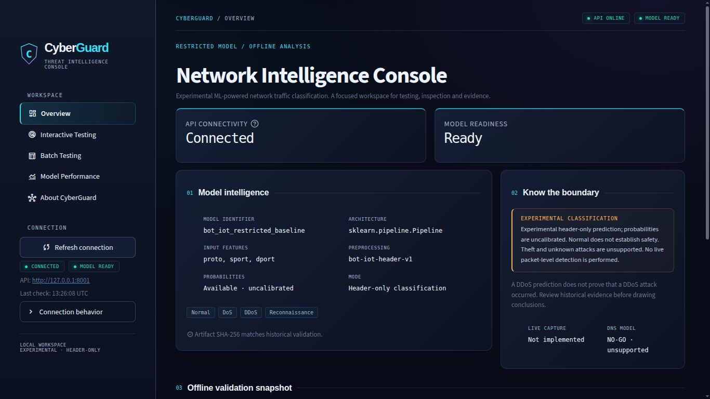

# CyberGuard dashboard redesign

Completed and visually verified on 2026-11-15. This work changes presentation and layout; it adds no ML, monitoring or inference functionality.

## Design changes

The original dashboard used oversized status values, long unstructured metadata paragraphs, default navigation and inconsistent chart presentation. The redesign introduces one visual system across all five pages:

- Dark atmospheric surfaces, restrained cyan/violet accents, subtle gradients and borders, compact technical labels and monospaced values. Display/body/technical fonts have local/system fallbacks; no font CDN is required.
- A CSS shield mark, native Material navigation icons, cyan active-page indicator, connection badges, contextual breadcrumb and minimal Streamlit toolbar. Navigation remains native Streamlit page links, including browser URLs and keyboard interaction.
- Reusable escaped components for branding, badges, section headings, metric cards, metadata grids, limitations banners, prediction cards, empty states, capability cards and the architecture diagram. Native Streamlit still owns inputs, state, layouts and downloads.
- Overview combines compact status cards, a model intelligence panel, explicit limitations and an offline validation snapshot. Benign scarcity and evaluation boundaries stay visible; exact per-class recalls/supports remain available in an expander.
- Interactive Testing uses adjacent input/result panels on laptop screens, a prominent **Analyze traffic** action, an explicit last-successful-result label, color-coded predicted class and horizontal uncalibrated probability bars. Input tokens, custom protocols and JSON null semantics are unchanged.
- Batch Testing groups import, preview, counts, progress, distribution and ordered results into numbered sections. A Plotly distribution uses consistent class colors: Normal teal, DoS orange, DDoS red, Reconnaissance violet. CSV parsing, limits, chunking, row order, complete-only results and safe export behavior are preserved.
- Model Performance uses metric cards, paired grouped-performance/support charts, a readable count/percentage heatmap and expandable exact tables. Support remains logarithmic with explicit counts, including the 79 Normal rows. The chart class order is aligned across views.
- About presents the real request path as four styled architecture nodes and separates implemented, planned and unsupported capabilities.

Layout uses available content width, not just viewport size: narrow analysis panels stack and metric rows wrap to two columns. Tables scroll internally where needed. Hover transitions are restrained; `prefers-reduced-motion` disables transitions/animations. There are no injected scripts, flashing effects, background workers or fabricated live statistics.

## Changed files

| File | Change |
| --- | --- |
| `src/cyberguard/dashboard/theme.py` | New shared visual/chart tokens and local stylesheet loader |
| `src/cyberguard/dashboard/theme.css` | New centralized palette, typography, panels, navigation, controls, motion and responsive rules |
| `src/cyberguard/dashboard/components/visuals.py` | New escaped reusable presentation components |
| `src/cyberguard/dashboard/components/metrics.py` | Styled metrics, methodology and capability components |
| `src/cyberguard/dashboard/components/charts.py` | Shared Plotly theme, horizontal probabilities, consistent class colors/order and batch distribution |
| `src/cyberguard/dashboard/app.py` | Branded shell, native icon page links, connection badges and contextual header |
| `src/cyberguard/dashboard/pages/overview.py` | Structured model/status/snapshot layout |
| `src/cyberguard/dashboard/pages/test_lab.py` | Responsive input/result workstation |
| `src/cyberguard/dashboard/pages/batch_testing.py` | Sectioned upload/result workspace and Plotly distribution |
| `src/cyberguard/dashboard/pages/model_performance.py` | Evidence panels, charts and exact-table expander |
| `src/cyberguard/dashboard/pages/about.py` | Styled architecture and project information |
| `.streamlit/config.toml` | Cohesive theme colors and minimal toolbar |
| `tests/unit/test_dashboard.py` | Updated UI expectations and chart-order regression assertion |
| `tests/unit/test_dashboard_design.py` | New escaping, class-color, input-parity and reduced-motion tests |
| `README.md` | Targeted UI/workflow/configuration updates, new test command and report link |
| `reports/dashboard_redesign/` | Actual browser screenshots of all pages and additional states |
| `reports/dashboard_redesign.md` | This completion record |

**New dependencies: none.** Existing Streamlit/Plotly/Pandas are reused. Launch commands, environment variables, HTTP contracts and API client/data-processing modules are unchanged. Existing uncommitted work was preserved. `AGENTS.md` already contains the permanent README-maintenance instruction and remains intact.

## Tests and security

- Final full suite: **182 passed in 2.88 seconds**. This includes the previous 172 tests and 10 new design tests. The 71 dashboard/design tests also pass independently of a running backend.
- Ruff lint/format checks and `git diff --check` passed.
- New tests parse rendered component markup with an HTML parser and verify malicious labels, metadata, warnings, model identifiers and badge tones stay text without creating script/image/event-handler elements or attributes. All dynamic custom HTML passes through one escaping helper; color/tone choices come from fixed allowlists. Streamlit sanitization remains enabled, with no `unsafe_allow_javascript` or `unsafe_allow_html` opt-in.
- Input-parity tests confirm the redesigned controls still send unchanged hexadecimal/sentinel strings and explicit null. Existing HTTP, CSV, order/chunking, export-injection, artifact-loading, missing-backend and no-polling tests continue passing.
- Chart tests preserve actual probability/count values, class colors, axis orientation, normalization and class order. Historical metrics are read from the existing reports, never regenerated through inference.

The full suite used normal local socket support for FastAPI TestClient, as documented in the existing README. Synthetic software fixtures are not evidence of model generalization.

## Browser verification

Inspected real browser screenshots at **1366 × 768** and **820 × 1024**. All five pages rendered and native page navigation worked. Desktop and tablet document widths matched their viewports, with no page-level horizontal overflow in the inspected workstation layouts.

Visual review found and corrected three practical issues: Streamlit sanitizes inline SVG in HTML components, so the mark/empty-state graphic now use CSS shapes; native page links do not expose an active-page ARIA attribute, so an owned keyed container supplies reliable active styling; tablet panels were too narrow beside the sidebar, so content-width container queries now stack them. Review also aligned chart class ordering and reduced header spacing to keep the primary action usable on laptop screens.

Functional browser checks:

1. Overview displayed actual service/model readiness, metadata and a matching historical artifact SHA-256.
2. Interactive `TCP,49152,80` returned the actual **DDoS** assignment and probability bars, including 57.3% DDoS. This is a software demonstration, not a verified attack.
3. Uploaded a real four-record synthetic CSV with an extra formula-like note and ICMP sentinel fields. All records remained ordered: **DDoS, Normal, Reconnaissance, Normal**. The completed downloaded CSV retained all four rows; the formula note and sentinel were escaped on export while preview tokens remained unchanged.
4. Historical macro-F1 **67.53%**, balanced accuracy **74.20%**, benign FPR **15.19%**, and **582,821** validation rows matched existing artifacts. Inspected grouped metrics, exact counts, normalized confusion cells and logarithmic supports.
5. Stopped a temporary API, submitted a prediction, and verified disconnected/unverified badges, cleared results and a disabled action. Model Performance remained usable offline. Restarting that API and using **Refresh connection** restored connected/ready status.

Port 8000 already had a backend running. Initial checks used it; controlled outage checks used a separate API on port 8001 with the dashboard's existing `CYBERGUARD_API_URL` override. The existing port-8000 service was left untouched. Temporary verification services were stopped after checks; default documented launch commands remain unchanged.

### Screenshot gallery

These are browser captures, not design mockups. Some show a scrolled section to make charts/results readable.

| View | Screenshot |
| --- | --- |
| Overview / sidebar | [Overview](dashboard_redesign/01-overview.jpg) |
| Interactive result | [Workstation](dashboard_redesign/02-interactive.jpg) |
| Batch distribution / ordered results | [Batch Testing](dashboard_redesign/03-batch.jpg) |
| Performance cards / charts | [Model Performance](dashboard_redesign/04-performance.jpg) |
| About / architecture | [About](dashboard_redesign/05-about.jpg) |
| Offline snapshot / capability map | [Overview details](dashboard_redesign/06-overview-validation.jpg) |
| Normalized confusion matrix | [Heatmap](dashboard_redesign/07-confusion-matrix.jpg) |
| Tablet stacked input / result | [Tablet input](dashboard_redesign/08-tablet.jpg), [tablet probabilities](dashboard_redesign/09-tablet-result.jpg) |
| Failed inference / disabled action | [Disconnected](dashboard_redesign/10-disconnected.jpg) |
| Historical charts without backend | [Offline performance](dashboard_redesign/11-offline-performance.jpg) |

## Integrity and known limitations

Before/after hashes match for all **nine** snapshotted raw CSV, fitted model, split manifest and preprocessing files. The five baseline-recorded training/preprocessing source hashes also match. The fitted model SHA-256 remains `93b744ada3af044e2d0e7d4dd6d5fa70870536e7a972443c806a232ce9052c6f`. Raw files were read only for byte-level integrity hashing, never for UI inference or evaluation. No model weights, preprocessing behavior, training scripts, reserved-test evaluation or API contracts changed.

The application is still an experimental, header-only offline classification interface with uncalibrated probabilities, scarce benign evidence and unsupported Theft/unknown/DNS classes. It has no live monitoring, replay or alert persistence. Status remains an explicit-check snapshot; prediction failures and refresh update it. Large results still use pagination and internal scrolling rather than widening the page.

Streamlit's layout primitives impose some styling limits. CSS uses owned component/key classes and stable semantic/test-id selectors, not generated class names; future Streamlit upgrades should receive a visual regression review. Font appearance depends on local availability and falls back safely. Desktop/laptop and one tablet size were inspected; this is not an exhaustive device/accessibility certification. No implementation blocker remains for the requested redesign.
