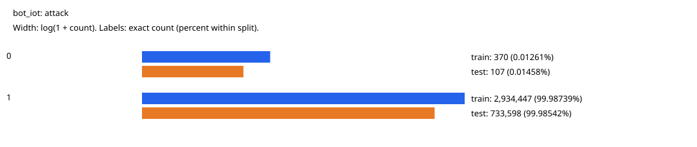
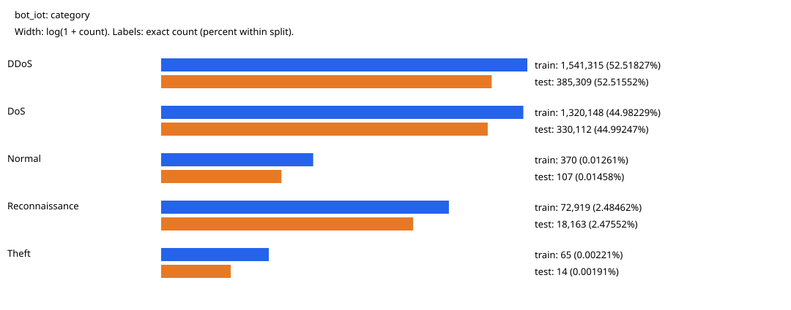
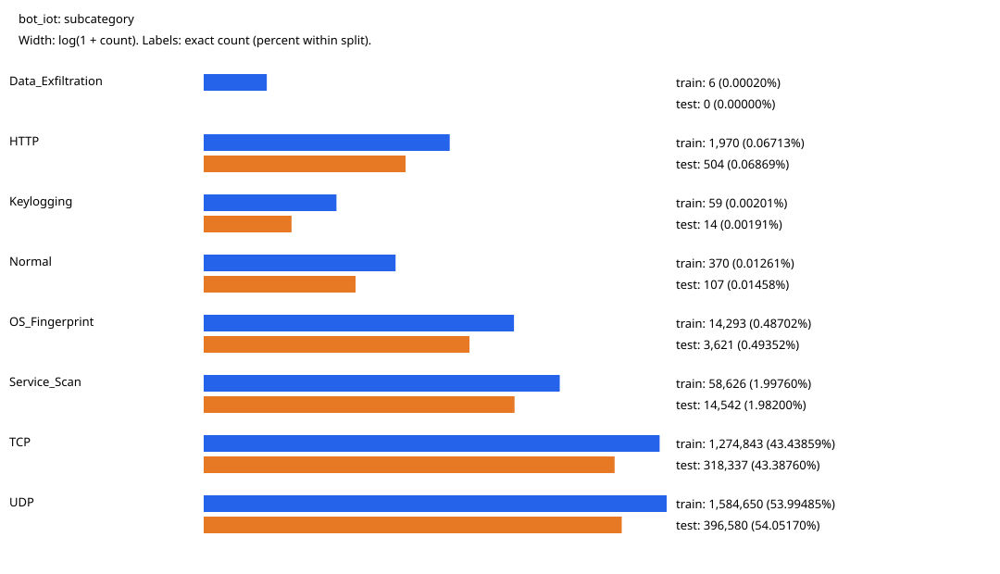
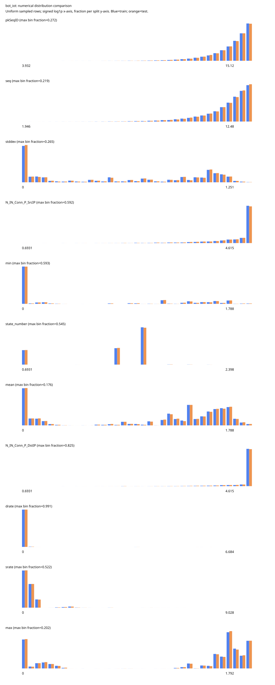

# BoT-IoT dataset analysis

Generated 2026-11-15T09:32:04.783461+00:00 (UTC).

## Method and limits

Full-file counts, finite-value moments and Pearson correlations are computed in chunks. Quantiles, histograms and 3×IQR outlier rates use a deterministic uniform priority sample per split (seed 20261115, test +1); they are estimates, not exact population quantiles. Unparseable, missing and infinite values are excluded from finite statistics; finite range violations remain visible in those statistics and are separately flagged. Sample outlier rates are undefined when IQR is zero. Near-constant means ≥99% of all rows have one value. Numerical majority counts use a second exact pass; categorical counts are exact. No rows are modified, dropped, merged into a training dataset, or used to fit a model.

SQLite compares parsed field strings (CSV quoting differences are immaterial), preserving case, whitespace and numeric spelling. BoT-IoT feature vectors use SHA-256 signatures of unambiguous JSON tuples; hash collision risk is negligible but these are signature checks rather than byte-by-byte collision verification. DNS feature keys are exact domain strings. Label conflicts compare the entire label tuple. These checks do not detect near-duplicates, semantically equivalent numeric spellings, or DNS case/trailing-dot equivalence. Cross-split queries join signatures only, not raw datasets.

## Dataset inspection

| Split | Rows | Columns | CSV MiB | String-column memory MiB¹ | Peak chunk MiB¹ | Sample rows |
| --- | --- | --- | --- | --- | --- | --- |
| train | 2,934,817 | 19 | 352.00 | 724.25 | 12.34 | 30000 |
| test | 733,705 | 19 | 88.01 | 181.07 | 12.34 | 30000 |

¹Deep pandas column bytes summed over chunks estimate full string-table memory; peak is one raw chunk only. Excludes Python counters, numeric arrays, sample copies and SQLite cache. Actual process peak RSS is in summary.md.

### train

Source: `data/raw/bot_iot/train/UNSW_2018_IoT_Botnet_Final_10_best_Training.csv`. Labels: `attack`, `category`, `subcategory`.

| Column | Observed read dtype | Role / semantic type | Missing | +/−infinity | Invalid¹ |
| --- | --- | --- | --- | --- | --- |
| pkSeqID | str | numeric (integer-valued) | 0 | 0 | 0 |
| proto | str | categorical / string | 0 | 0 | 0 |
| saddr | str | categorical / string | 0 | 0 | 0 |
| sport | str | categorical port token / numeric semantics | 0 | 0 | 166 |
| daddr | str | categorical / string | 0 | 0 | 0 |
| dport | str | categorical port token / numeric semantics | 0 | 0 | 166 |
| seq | str | numeric (integer-valued) | 0 | 0 | 0 |
| stddev | str | numeric (floating point) | 0 | 0 | 0 |
| N_IN_Conn_P_SrcIP | str | numeric (integer-valued) | 0 | 0 | 0 |
| min | str | numeric (floating point) | 0 | 0 | 0 |
| state_number | str | numeric (integer-valued) | 0 | 0 | 0 |
| mean | str | numeric (floating point) | 0 | 0 | 0 |
| N_IN_Conn_P_DstIP | str | numeric (integer-valued) | 0 | 0 | 0 |
| drate | str | numeric (floating point) | 0 | 0 | 0 |
| srate | str | numeric (floating point) | 0 | 0 | 0 |
| max | str | numeric (floating point) | 0 | 0 | 0 |
| attack | str | label (categorical) | 0 | 0 | 0 |
| category | str | label (categorical) | 0 | 0 | 0 |
| subcategory | str | label (categorical) | 0 | 0 | 0 |

CSV has no intrinsic stored dtypes; integer/floating semantics above are inferred across all finite numerical values. All fields are deliberately read as strings to preserve mixed port tokens and duplicate identity. Semantic numerical/categorical roles are above; labels and encoded state/protocol are categorical even when integer-valued. Missing means empty/whitespace; numeric fields also recognize NA/nan/null/none/n/a. Literal domain strings such as 'nan' are not automatically missing.

¹Invalid checks: expected numeric parsing and nonnegative values, IP syntax, port range 0–65535 (hex allowed), and attack∈{0,1}. DNS class codes are only checked as nonnegative integers; their meaning is unverified. DNS lexical flags below are screening observations, not definitive invalidity judgments. No protocol/state dictionary is supplied, so unknown codes cannot be validated. Empty categories are counted as missing.

Validation observations:

| Check | Rows |
| --- | --- |
| attack/category inconsistency | 0 |
| dport: hexadecimal tokens | 7228 |
| dport: special '-' (not numeric) | 0 |
| dport: token -1 with proto=arp | 166 |
| mean > max | 0 |
| min > mean | 0 |
| sport: hexadecimal tokens | 7228 |
| sport: special '-' (not numeric) | 0 |
| sport: token -1 with proto=arp | 166 |

| Column | Invalid token examples |
| --- | --- |
| sport | -1 |
| dport | -1 |

Constant columns: none (numeric constants use finite values; see missing counts).

| Near-constant column (labels included for diagnosis) | Dominant value | Count | Share |
| --- | --- | --- | --- |
| attack | 1 | 2934447 | 99.98739% |

### test

Source: `data/raw/bot_iot/test/UNSW_2018_IoT_Botnet_Final_10_best_Testing.csv`. Labels: `attack`, `category`, `subcategory`.

| Column | Observed read dtype | Role / semantic type | Missing | +/−infinity | Invalid¹ |
| --- | --- | --- | --- | --- | --- |
| pkSeqID | str | numeric (integer-valued) | 0 | 0 | 0 |
| proto | str | categorical / string | 0 | 0 | 0 |
| saddr | str | categorical / string | 0 | 0 | 0 |
| sport | str | categorical port token / numeric semantics | 0 | 0 | 47 |
| daddr | str | categorical / string | 0 | 0 | 0 |
| dport | str | categorical port token / numeric semantics | 0 | 0 | 47 |
| seq | str | numeric (integer-valued) | 0 | 0 | 0 |
| stddev | str | numeric (floating point) | 0 | 0 | 0 |
| N_IN_Conn_P_SrcIP | str | numeric (integer-valued) | 0 | 0 | 0 |
| min | str | numeric (floating point) | 0 | 0 | 0 |
| state_number | str | numeric (integer-valued) | 0 | 0 | 0 |
| mean | str | numeric (floating point) | 0 | 0 | 0 |
| N_IN_Conn_P_DstIP | str | numeric (integer-valued) | 0 | 0 | 0 |
| drate | str | numeric (floating point) | 0 | 0 | 0 |
| srate | str | numeric (floating point) | 0 | 0 | 0 |
| max | str | numeric (floating point) | 0 | 0 | 0 |
| attack | str | label (categorical) | 0 | 0 | 0 |
| category | str | label (categorical) | 0 | 0 | 0 |
| subcategory | str | label (categorical) | 0 | 0 | 0 |

CSV has no intrinsic stored dtypes; integer/floating semantics above are inferred across all finite numerical values. All fields are deliberately read as strings to preserve mixed port tokens and duplicate identity. Semantic numerical/categorical roles are above; labels and encoded state/protocol are categorical even when integer-valued. Missing means empty/whitespace; numeric fields also recognize NA/nan/null/none/n/a. Literal domain strings such as 'nan' are not automatically missing.

¹Invalid checks: expected numeric parsing and nonnegative values, IP syntax, port range 0–65535 (hex allowed), and attack∈{0,1}. DNS class codes are only checked as nonnegative integers; their meaning is unverified. DNS lexical flags below are screening observations, not definitive invalidity judgments. No protocol/state dictionary is supplied, so unknown codes cannot be validated. Empty categories are counted as missing.

Validation observations:

| Check | Rows |
| --- | --- |
| attack/category inconsistency | 0 |
| dport: hexadecimal tokens | 1824 |
| dport: special '-' (not numeric) | 0 |
| dport: token -1 with proto=arp | 47 |
| mean > max | 0 |
| min > mean | 0 |
| sport: hexadecimal tokens | 1824 |
| sport: special '-' (not numeric) | 0 |
| sport: token -1 with proto=arp | 47 |

| Column | Invalid token examples |
| --- | --- |
| sport | -1 |
| dport | -1 |

Constant columns: none (numeric constants use finite values; see missing counts).

| Near-constant column (labels included for diagnosis) | Dominant value | Count | Share |
| --- | --- | --- | --- |
| attack | 1 | 733598 | 99.98542% |

## Class distributions and split comparison

### `attack`

| Class | Train n | Train % | Test n | Test % | Test−train pp |
| --- | --- | --- | --- | --- | --- |
| 0 | 370 | 0.012607 | 107 | 0.014584 | +0.001976 |
| 1 | 2,934,447 | 99.987393 | 733,598 | 99.985416 | -0.001976 |

Classes absent from test: none; absent from train: none. Recall is not measurable for a class with zero test support.

train: minority `0` = 370 (0.012607%); majority/minority ratio = 7930.94:1. Classes under 1%: 0.

test: minority `0` = 107 (0.014584%); majority/minority ratio = 6856.06:1. Classes under 1%: 0.

### `category`

| Class | Train n | Train % | Test n | Test % | Test−train pp |
| --- | --- | --- | --- | --- | --- |
| DDoS | 1,541,315 | 52.518266 | 385,309 | 52.515521 | -0.002746 |
| DoS | 1,320,148 | 44.982294 | 330,112 | 44.992470 | +0.010176 |
| Normal | 370 | 0.012607 | 107 | 0.014584 | +0.001976 |
| Reconnaissance | 72,919 | 2.484618 | 18,163 | 2.475518 | -0.009100 |
| Theft | 65 | 0.002215 | 14 | 0.001908 | -0.000307 |

Classes absent from test: none; absent from train: none. Recall is not measurable for a class with zero test support.

train: minority `Theft` = 65 (0.002215%); majority/minority ratio = 23712.54:1. Classes under 1%: Normal, Theft.

test: minority `Theft` = 14 (0.001908%); majority/minority ratio = 27522.07:1. Classes under 1%: Normal, Theft.

### `subcategory`

| Class | Train n | Train % | Test n | Test % | Test−train pp |
| --- | --- | --- | --- | --- | --- |
| Data_Exfiltration | 6 | 0.000204 | 0 | 0.000000 | -0.000204 |
| HTTP | 1,970 | 0.067125 | 504 | 0.068692 | +0.001567 |
| Keylogging | 59 | 0.002010 | 14 | 0.001908 | -0.000102 |
| Normal | 370 | 0.012607 | 107 | 0.014584 | +0.001976 |
| OS_Fingerprint | 14,293 | 0.487015 | 3,621 | 0.493523 | +0.006508 |
| Service_Scan | 58,626 | 1.997603 | 14,542 | 1.981995 | -0.015608 |
| TCP | 1,274,843 | 43.438586 | 318,337 | 43.387601 | -0.050984 |
| UDP | 1,584,650 | 53.994849 | 396,580 | 54.051697 | +0.056848 |

Classes absent from test: Data_Exfiltration; absent from train: none. Recall is not measurable for a class with zero test support.

train: minority `Data_Exfiltration` = 6 (0.000204%); majority/minority ratio = 264108.33:1. Classes under 1%: OS_Fingerprint, HTTP, Normal, Keylogging, Data_Exfiltration.

test: minority `Keylogging` = 14 (0.001908%); majority/minority ratio = 28327.14:1. Classes under 1%: HTTP, OS_Fingerprint, Normal, Keylogging.

## Feature distributions and descriptive statistics

Moments below cover every finite value; skew is the population standardized third central moment. Ports are parsed numerically for diagnostics only, while preserving their categorical tokens. Domain length is an analysis-only measurement, not an implemented preprocessing pipeline.

### train

| Column | Finite n | Mean | SD | Min | Max | Skew | Sample p01 / p25 / p50 / p75 / p99 | Sample extreme % (3×IQR) |
| --- | --- | --- | --- | --- | --- | --- | --- | --- |
| pkSeqID | 2934817 | 1.83421e+06 | 1.05906e+06 | 1 | 3.66852e+06 | 7.71135e-05 | 39233.7 / 917118 / 1.83316e+06 / 2.74685e+06 / 3.63037e+06 | 0 |
| seq | 2934817 | 121297 | 75787 | 1 | 262211 | 0.134086 | 1439.99 / 54639.5 / 117006 / 183018 / 258725 | 0 |
| stddev | 2934817 | 0.886964 | 0.803639 | 0 | 2.49676 | 0.187201 | 0 / 0.0321323 / 0.797944 / 1.74475 / 2.21306 | 0 |
| N_IN_Conn_P_SrcIP | 2934817 | 82.55 | 24.3902 | 1 | 100 | -1.28707 | 14 / 69 / 100 / 100 / 100 | 0 |
| min | 2934817 | 1.01721 | 1.48355 | 0 | 4.98047 | 1.00779 | 0 / 0 / 0 / 2.35218 / 4.42018 | 0 |
| state_number | 2934817 | 3.13422 | 1.18711 | 1 | 11 | -0.956057 | 1 / 3 / 4 / 4 / 4 | 0.00333333 |
| mean | 2934817 | 2.23047 | 1.51777 | 0 | 4.98188 | -0.378355 | 0 / 0.189578 / 2.69712 / 3.56724 / 4.53719 | 0 |
| N_IN_Conn_P_DstIP | 2934817 | 92.4577 | 18.1665 | 1 | 100 | -2.64621 | 20 / 100 / 100 / 100 / 100 | undefined |
| drate | 2934817 | 0.430306 | 56.233 | 0 | 58823.5 | 791.296 | 0 / 0 / 0 / 0 / 0.163699 | undefined |
| srate | 2934817 | 3.12829 | 784.549 | 0 | 1e+06 | 878.663 | 0 / 0.157371 / 0.283637 / 0.488446 / 5.88675 | 3.36333 |
| max | 2934817 | 3.01927 | 1.86091 | 0 | 5 | -0.805759 | 0 / 0.288127 / 4.00038 / 4.28091 / 4.99667 | 0 |
| sport | 2934817 | 32944.4 | 19114.4 | -1 | 65535 | -0.0280653 | 643.99 / 16587.2 / 33656 / 49754.8 / 64873 | 0 |
| dport | 2934817 | 392.307 | 3320.85 | -1 | 65535 | 13.5857 | 80 / 80 / 80 / 80 / 6881 | undefined |

Features with |population skew| >2: N_IN_Conn_P_DstIP, drate, srate, dport. Extreme values are investigation candidates, not automatic removal criteria; attacks may produce legitimate extremes.

### test

| Column | Finite n | Mean | SD | Min | Max | Skew | Sample p01 / p25 / p50 / p75 / p99 | Sample extreme % (3×IQR) |
| --- | --- | --- | --- | --- | --- | --- | --- | --- |
| pkSeqID | 733705 | 1.83447e+06 | 1.05883e+06 | 2 | 3.66851e+06 | -0.000308395 | 35926.2 / 907438 / 1.82207e+06 / 2.73816e+06 / 3.63022e+06 | 0 |
| seq | 733705 | 121413 | 75823.4 | 1 | 262212 | 0.132759 | 1789.89 / 55935.2 / 118007 / 185250 / 258860 | 0 |
| stddev | 733705 | 0.887894 | 0.804013 | 0 | 2.49676 | 0.186284 | 0 / 0.029194 / 0.783748 / 1.74488 / 2.20902 | 0 |
| N_IN_Conn_P_SrcIP | 733705 | 82.4926 | 24.4261 | 1 | 100 | -1.28236 | 14 / 68 / 99 / 100 / 100 | 0 |
| min | 733705 | 1.01887 | 1.48424 | 0 | 4.98047 | 1.00529 | 0 / 0 / 0 / 2.18586 / 4.44719 | 0 |
| state_number | 733705 | 3.13507 | 1.18643 | 1 | 11 | -0.956628 | 1 / 3 / 4 / 4 / 4 | 0.00333333 |
| mean | 733705 | 2.23343 | 1.51757 | 0 | 4.98179 | -0.381827 | 0 / 0.182583 / 2.68993 / 3.56974 / 4.56243 | 0 |
| N_IN_Conn_P_DstIP | 733705 | 92.4278 | 18.2161 | 1 | 100 | -2.64027 | 18 / 100 / 100 / 100 / 100 | undefined |
| drate | 733705 | 0.506298 | 74.3302 | 0 | 58823.5 | 685.898 | 0 / 0 / 0 / 0 / 0.163564 | undefined |
| srate | 733705 | 2.2624 | 403.408 | 0 | 333333 | 772.401 | 0 / 0.156081 / 0.283158 / 0.485868 / 5.90433 | 3.36667 |
| max | 733705 | 3.023 | 1.86073 | 0 | 5 | -0.809339 | 0 / 0.27844 / 4.00676 / 4.29212 / 4.99666 | 0 |
| sport | 733705 | 32910.1 | 19124.1 | -1 | 65535 | -0.024973 | 566.99 / 16525.2 / 33258 / 49759 / 64850 | 0 |
| dport | 733705 | 393.852 | 3326.29 | -1 | 65535 | 13.5414 | 80 / 80 / 80 / 80 / 7911.27 | undefined |

Features with |population skew| >2: N_IN_Conn_P_DstIP, drate, srate, dport. Extreme values are investigation candidates, not automatic removal criteria; attacks may produce legitimate extremes.

## Correlations and redundancy

train: pairwise-complete Pearson correlations; high-correlation candidates |r|≥0.90. Constant columns yield undefined correlations. IDs are included diagnostically; port tokens are excluded from Pearson correlation because their magnitude is not a meaningful continuous measurement.

| Feature A | Feature B | Pearson r |
| --- | --- | --- |
| mean | max | 0.908659 |

[Complete correlation matrix](bot_iot_train_correlations.csv). Correlation is association, not a feature-removal instruction.

test: pairwise-complete Pearson correlations; high-correlation candidates |r|≥0.90. Constant columns yield undefined correlations. IDs are included diagnostically; port tokens are excluded from Pearson correlation because their magnitude is not a meaningful continuous measurement.

| Feature A | Feature B | Pearson r |
| --- | --- | --- |
| mean | max | 0.90854 |

[Complete correlation matrix](bot_iot_test_correlations.csv). Correlation is association, not a feature-removal instruction.

Duration aggregates may be redundant even below this threshold. Evaluate removing one of each strongly correlated pair inside training validation only; never use test performance to select predictors.

## Categorical cardinality

### train

| Column | Distinct | Distinct / rows % | Top values: counts |
| --- | --- | --- | --- |
| proto | 5 | 0.0002 | udp: 1,596,819; tcp: 1,330,598; icmp: 7,228; arp: 166; ipv6-icmp: 6 |
| saddr | 20 | 0.0007 | 192.168.100.147: 761,360; 192.168.100.148: 738,642; 192.168.100.150: 712,260; 192.168.100.149: 711,466; 192.168.100.3: 6,609 |
| sport | 65541 | 2.2332 | 0x0303: 7,156; 80: 3,220; 1822: 878; 60541: 869; 1216: 868 |
| daddr | 81 | 0.0028 | 192.168.100.3: 1,900,562; 192.168.100.5: 361,192; 192.168.100.7: 332,161; 192.168.100.6: 329,679; 192.168.100.150: 3,040 |
| dport | 6906 | 0.2353 | 80: 2,858,794; 1: 5,379; 3306: 3,757; 53: 275; -1: 166 |
| state_number | 11 | 0.0004 | 4: 1,596,641; 3: 703,025; 1: 620,330; 5: 7,156; 6: 5,182 |
| attack | 2 | 0.0001 | 1: 2,934,447; 0: 370 |
| category | 5 | 0.0002 | DDoS: 1,541,315; DoS: 1,320,148; Reconnaissance: 72,919; Normal: 370; Theft: 65 |
| subcategory | 8 | 0.0003 | UDP: 1,584,650; TCP: 1,274,843; Service_Scan: 58,626; OS_Fingerprint: 14,293; HTTP: 1,970 |

`proto` → category weighted majority purity: 55.0832% (diagnostic association, not a validation score).

| proto | Category counts |
| --- | --- |
| arp | {'Reconnaissance': 60, 'DDoS': 25, 'Normal': 38, 'DoS': 40, 'Theft': 3} |
| icmp | {'Reconnaissance': 7206, 'DDoS': 12, 'DoS': 10} |
| ipv6-icmp | {'Normal': 6} |
| tcp | {'DDoS': 782999, 'DoS': 493777, 'Reconnaissance': 53723, 'Normal': 37, 'Theft': 62} |
| udp | {'DDoS': 758279, 'DoS': 826321, 'Reconnaissance': 11930, 'Normal': 289} |

`saddr` → category weighted majority purity: 52.6935% (diagnostic association, not a validation score).

| saddr | Category counts |
| --- | --- |
| 192.168.100.1 | {'Normal': 14} |
| 192.168.100.147 | {'DDoS': 416171, 'DoS': 328338, 'Reconnaissance': 16814, 'Normal': 37} |
| 192.168.100.148 | {'DoS': 326164, 'DDoS': 395828, 'Reconnaissance': 16605, 'Normal': 45} |
| 192.168.100.149 | {'DoS': 336420, 'DDoS': 360863, 'Reconnaissance': 14146, 'Normal': 36, 'Theft': 1} |
| 192.168.100.150 | {'DDoS': 365677, 'DoS': 328785, 'Reconnaissance': 17728, 'Normal': 48, 'Theft': 22} |
| 192.168.100.27 | {'Normal': 9} |
| 192.168.100.3 | {'Reconnaissance': 3572, 'DDoS': 2776, 'Normal': 106, 'DoS': 113, 'Theft': 42} |
| 192.168.100.4 | {'Normal': 17} |
| 192.168.100.46 | {'Normal': 8} |
| 192.168.100.5 | {'Reconnaissance': 4022, 'Normal': 10, 'DoS': 75} |
| 192.168.100.55 | {'Normal': 3} |
| 192.168.100.6 | {'DoS': 245, 'Reconnaissance': 18, 'Normal': 9} |
| 192.168.100.7 | {'Reconnaissance': 14, 'DoS': 8, 'Normal': 12} |
| fe80::250:56ff:febe:254 | {'Normal': 5} |
| fe80::250:56ff:febe:26db | {'Normal': 2} |
| fe80::250:56ff:febe:89ee | {'Normal': 2} |
| fe80::250:56ff:febe:c038 | {'Normal': 2} |
| fe80::250:56ff:febe:e9d9 | {'Normal': 1} |
| fe80::2c6a:ff9b:7e14:166a | {'Normal': 2} |
| fe80::c0c0:aa20:45b9:bdd9 | {'Normal': 2} |

`daddr` → category weighted majority purity: 86.4477% (diagnostic association, not a validation score).

| daddr | Category counts |
| --- | --- |
| 128.63.2.53 | {'Normal': 2} |
| 129.250.35.250 | {'Normal': 2} |
| 13.55.154.73 | {'Normal': 4} |
| 156.154.100.3 | {'Normal': 1} |
| 172.217.25.170 | {'Normal': 2} |
| 184.85.248.65 | {'Normal': 1} |
| 192.112.36.4 | {'Normal': 2} |
| 192.12.94.30 | {'Normal': 4} |
| 192.168.100.1 | {'Normal': 27} |
| 192.168.100.147 | {'Reconnaissance': 1842, 'DDoS': 1078, 'DoS': 7, 'Normal': 1} |
| 192.168.100.148 | {'Reconnaissance': 1953, 'DoS': 246, 'DDoS': 206, 'Normal': 1} |
| 192.168.100.149 | {'Reconnaissance': 1952, 'DDoS': 467, 'DoS': 75, 'Theft': 20, 'Normal': 1} |
| 192.168.100.150 | {'Reconnaissance': 1879, 'DDoS': 1025, 'DoS': 113, 'Theft': 22, 'Normal': 1} |
| 192.168.100.255 | {'Normal': 9} |
| 192.168.100.27 | {'Normal': 3} |
| 192.168.100.3 | {'DDoS': 1538539, 'DoS': 329125, 'Reconnaissance': 32856, 'Normal': 20, 'Theft': 22} |
| 192.168.100.4 | {'Normal': 7} |
| 192.168.100.5 | {'DoS': 336080, 'Reconnaissance': 25103, 'Normal': 9} |
| 192.168.100.55 | {'Normal': 2} |
| 192.168.100.6 | {'DoS': 325933, 'Reconnaissance': 3745, 'Theft': 1} |
| 192.168.100.7 | {'DoS': 328569, 'Reconnaissance': 3589, 'Normal': 3} |
| 192.168.217.2 | {'Normal': 44} |
| 192.203.230.10 | {'Normal': 2} |
| 192.26.92.30 | {'Normal': 2} |
| 192.31.80.30 | {'Normal': 3} |
| 192.33.14.30 | {'Normal': 1} |
| 192.33.4.12 | {'Normal': 2} |
| 192.35.51.30 | {'Normal': 2} |
| 192.36.148.17 | {'Normal': 3} |
| 192.41.162.30 | {'Normal': 5} |
| 192.42.93.30 | {'Normal': 2} |
| 192.48.79.30 | {'Normal': 1} |
| 192.5.5.241 | {'Normal': 5} |
| 192.52.178.30 | {'Normal': 3} |
| 192.54.112.30 | {'Normal': 1} |
| 192.55.83.30 | {'Normal': 1} |
| 192.58.128.30 | {'Normal': 2} |
| 198.41.0.4 | {'Normal': 1} |
| 199.19.56.1 | {'Normal': 2} |
| 199.19.57.1 | {'Normal': 3} |
| 199.7.83.42 | {'Normal': 3} |
| 199.7.91.13 | {'Normal': 2} |
| 202.12.27.33 | {'Normal': 2} |
| 205.251.192.170 | {'Normal': 1} |
| 205.251.193.2 | {'Normal': 3} |
| 205.251.194.102 | {'Normal': 1} |
| 205.251.194.154 | {'Normal': 1} |
| 205.251.194.167 | {'Normal': 1} |
| 205.251.194.201 | {'Normal': 1} |
| 205.251.194.84 | {'Normal': 1} |
| 205.251.194.86 | {'Normal': 2} |
| 205.251.195.185 | {'Normal': 1} |
| 205.251.195.59 | {'Normal': 2} |
| 205.251.195.97 | {'Normal': 2} |
| 205.251.196.160 | {'Normal': 1} |
| 205.251.196.236 | {'Normal': 2} |
| 205.251.196.32 | {'Normal': 2} |
| 205.251.197.206 | {'Normal': 2} |
| 205.251.198.119 | {'Normal': 1} |
| 205.251.198.239 | {'Normal': 2} |
| 205.251.198.91 | {'Normal': 4} |
| 205.251.199.148 | {'Normal': 1} |
| 205.251.199.194 | {'Normal': 1} |
| 205.251.199.61 | {'Normal': 1} |
| 216.239.34.10 | {'Normal': 2} |
| 216.239.36.10 | {'Normal': 1} |
| 216.239.38.10 | {'Normal': 1} |
| 224.0.0.251 | {'Normal': 42} |
| 224.0.0.252 | {'Normal': 1} |
| 255.255.255.255 | {'Normal': 4} |
| 27.124.125.250 | {'Normal': 12} |
| 52.11.124.117 | {'Normal': 4} |
| 52.201.147.106 | {'Normal': 4} |
| 52.35.35.13 | {'Normal': 1} |
| 8.8.8.8 | {'Normal': 48} |
| 91.189.91.157 | {'Normal': 3} |
| 91.189.92.40 | {'Normal': 2} |
| 96.7.49.66 | {'Normal': 2} |
| ff02::1 | {'Normal': 3} |
| ff02::2 | {'Normal': 6} |
| ff02::fb | {'Normal': 7} |

`state_number` → category weighted majority purity: 55.2646% (diagnostic association, not a validation score).

| state_number | Category counts |
| --- | --- |
| 1 | {'DoS': 222263, 'DDoS': 350098, 'Reconnaissance': 47921, 'Theft': 46, 'Normal': 2} |
| 10 | {'Reconnaissance': 10} |
| 11 | {'Reconnaissance': 8} |
| 2 | {'Normal': 233, 'Reconnaissance': 110, 'DDoS': 22, 'DoS': 40, 'Theft': 3} |
| 3 | {'DDoS': 430902, 'DoS': 271514, 'Reconnaissance': 609} |
| 4 | {'DDoS': 758282, 'DoS': 826321, 'Reconnaissance': 11920, 'Normal': 118} |
| 5 | {'Reconnaissance': 7134, 'DDoS': 12, 'DoS': 10} |
| 6 | {'Reconnaissance': 5153, 'Normal': 11, 'Theft': 16, 'DDoS': 2} |
| 7 | {'DDoS': 1997} |
| 8 | {'Normal': 6} |
| 9 | {'Reconnaissance': 54} |

### test

| Column | Distinct | Distinct / rows % | Top values: counts |
| --- | --- | --- | --- |
| proto | 5 | 0.0007 | udp: 399,618; tcp: 332,214; icmp: 1,824; arp: 47; ipv6-icmp: 2 |
| saddr | 16 | 0.0022 | 192.168.100.147: 189,606; 192.168.100.148: 184,648; 192.168.100.149: 178,680; 192.168.100.150: 178,002; 192.168.100.3: 1,672 |
| sport | 65538 | 8.9325 | 0x0303: 1,794; 80: 792; 51456: 247; 35008: 244; 59626: 240 |
| daddr | 45 | 0.0061 | 192.168.100.3: 475,171; 192.168.100.5: 90,502; 192.168.100.7: 82,698; 192.168.100.6: 82,530; 192.168.100.150: 820 |
| dport | 4111 | 0.5603 | 80: 714,781; 1: 1,366; 3306: 856; 53: 65; 21: 54 |
| state_number | 11 | 0.0015 | 4: 399,567; 3: 175,672; 1: 154,838; 5: 1,794; 6: 1,205 |
| attack | 2 | 0.0003 | 1: 733,598; 0: 107 |
| category | 5 | 0.0007 | DDoS: 385,309; DoS: 330,112; Reconnaissance: 18,163; Normal: 107; Theft: 14 |
| subcategory | 7 | 0.0010 | UDP: 396,580; TCP: 318,337; Service_Scan: 14,542; OS_Fingerprint: 3,621; HTTP: 504 |

`proto` → category weighted majority purity: 55.0362% (diagnostic association, not a validation score).

| proto | Category counts |
| --- | --- |
| arp | {'Reconnaissance': 18, 'DoS': 9, 'DDoS': 10, 'Normal': 9, 'Theft': 1} |
| icmp | {'Reconnaissance': 1816, 'DDoS': 4, 'DoS': 4} |
| ipv6-icmp | {'Normal': 2} |
| tcp | {'DDoS': 195351, 'DoS': 123483, 'Reconnaissance': 13357, 'Theft': 13, 'Normal': 10} |
| udp | {'DoS': 206616, 'DDoS': 189944, 'Reconnaissance': 2972, 'Normal': 86} |

`saddr` → category weighted majority purity: 52.6866% (diagnostic association, not a validation score).

| saddr | Category counts |
| --- | --- |
| 192.168.100.1 | {'Normal': 2} |
| 192.168.100.147 | {'DDoS': 103793, 'DoS': 81731, 'Reconnaissance': 4071, 'Normal': 11} |
| 192.168.100.148 | {'DDoS': 98811, 'DoS': 81620, 'Reconnaissance': 4205, 'Normal': 12} |
| 192.168.100.149 | {'DDoS': 90730, 'DoS': 84311, 'Reconnaissance': 3627, 'Normal': 12} |
| 192.168.100.150 | {'DoS': 82366, 'DDoS': 91265, 'Reconnaissance': 4354, 'Theft': 5, 'Normal': 12} |
| 192.168.100.27 | {'Normal': 5} |
| 192.168.100.3 | {'DDoS': 710, 'Reconnaissance': 899, 'Normal': 33, 'DoS': 21, 'Theft': 9} |
| 192.168.100.4 | {'Normal': 2} |
| 192.168.100.46 | {'Normal': 7} |
| 192.168.100.5 | {'Reconnaissance': 995, 'DoS': 14, 'Normal': 2} |
| 192.168.100.6 | {'DoS': 44, 'Normal': 2, 'Reconnaissance': 9} |
| 192.168.100.7 | {'Reconnaissance': 3, 'DoS': 5, 'Normal': 1} |
| fe80::250:56ff:febe:254 | {'Normal': 1} |
| fe80::250:56ff:febe:bf1a | {'Normal': 2} |
| fe80::250:56ff:febe:e9d9 | {'Normal': 1} |
| fe80::c0c0:aa20:45b9:bdd9 | {'Normal': 2} |

`daddr` → category weighted majority purity: 86.4354% (diagnostic association, not a validation score).

| daddr | Category counts |
| --- | --- |
| 129.250.35.250 | {'Normal': 2} |
| 13.55.154.73 | {'Normal': 1} |
| 156.154.100.3 | {'Normal': 1} |
| 156.154.101.3 | {'Normal': 2} |
| 172.217.25.170 | {'Normal': 2} |
| 192.12.94.30 | {'Normal': 2} |
| 192.168.100.1 | {'Normal': 10} |
| 192.168.100.147 | {'Reconnaissance': 464, 'DDoS': 261, 'DoS': 5} |
| 192.168.100.148 | {'Reconnaissance': 476, 'DoS': 44, 'DDoS': 43} |
| 192.168.100.149 | {'DDoS': 115, 'DoS': 14, 'Reconnaissance': 462, 'Theft': 5} |
| 192.168.100.150 | {'Reconnaissance': 504, 'DDoS': 291, 'DoS': 21, 'Theft': 4} |
| 192.168.100.255 | {'Normal': 4} |
| 192.168.100.3 | {'DoS': 82447, 'DDoS': 384599, 'Reconnaissance': 8116, 'Theft': 5, 'Normal': 4} |
| 192.168.100.4 | {'Normal': 1} |
| 192.168.100.5 | {'DoS': 84230, 'Reconnaissance': 6265, 'Normal': 7} |
| 192.168.100.6 | {'DoS': 81557, 'Reconnaissance': 973} |
| 192.168.100.7 | {'DoS': 81794, 'Reconnaissance': 903, 'Normal': 1} |
| 192.168.217.2 | {'Normal': 15} |
| 192.33.14.30 | {'Normal': 1} |
| 192.33.4.12 | {'Normal': 1} |
| 192.35.51.30 | {'Normal': 1} |
| 192.41.162.30 | {'Normal': 1} |
| 192.42.93.30 | {'Normal': 1} |
| 192.5.5.241 | {'Normal': 2} |
| 192.54.112.30 | {'Normal': 1} |
| 192.55.83.30 | {'Normal': 1} |
| 192.58.128.30 | {'Normal': 1} |
| 199.19.57.1 | {'Normal': 1} |
| 199.7.83.42 | {'Normal': 1} |
| 199.7.91.13 | {'Normal': 1} |
| 205.251.192.170 | {'Normal': 1} |
| 205.251.193.205 | {'Normal': 2} |
| 205.251.194.102 | {'Normal': 1} |
| 205.251.194.201 | {'Normal': 1} |
| 205.251.194.84 | {'Normal': 1} |
| 205.251.195.97 | {'Normal': 1} |
| 205.251.196.160 | {'Normal': 1} |
| 205.251.199.148 | {'Normal': 1} |
| 224.0.0.251 | {'Normal': 13} |
| 35.165.2.252 | {'Normal': 1} |
| 8.8.8.8 | {'Normal': 12} |
| 91.189.91.157 | {'Normal': 1} |
| ff02::1 | {'Normal': 1} |
| ff02::2 | {'Normal': 2} |
| ff02::fb | {'Normal': 3} |

`state_number` → category weighted majority purity: 55.2056% (diagnostic association, not a validation score).

| state_number | Category counts |
| --- | --- |
| 1 | {'DDoS': 87181, 'Reconnaissance': 11998, 'DoS': 55651, 'Theft': 8} |
| 10 | {'Reconnaissance': 6} |
| 11 | {'Reconnaissance': 8} |
| 2 | {'Normal': 64, 'Reconnaissance': 34, 'DoS': 9, 'DDoS': 10, 'Theft': 1} |
| 3 | {'DoS': 67832, 'DDoS': 107691, 'Reconnaissance': 149} |
| 4 | {'DoS': 206616, 'DDoS': 189944, 'Reconnaissance': 2969, 'Normal': 38} |
| 5 | {'Reconnaissance': 1786, 'DDoS': 4, 'DoS': 4} |
| 6 | {'Reconnaissance': 1197, 'Theft': 5, 'Normal': 3} |
| 7 | {'DDoS': 479} |
| 8 | {'Normal': 2} |
| 9 | {'Reconnaissance': 16} |

## Duplicate, overlap and conflicting-label audit

Duplicate excess is sum(group size−1); duplicate groups have size>1. Shared groups count distinct (feature vector, complete label tuple) pairs; affected rows are reported separately. Conflicting vectors have more than one complete label tuple. Both splits retain all their rows.

### raw feature view

Features: `pkSeqID, proto, saddr, sport, daddr, dport, seq, stddev, N_IN_Conn_P_SrcIP, min, state_number, mean, N_IN_Conn_P_DstIP, drate, srate, max`. Labels: `attack, category, subcategory`.

| Measure | Count |
| --- | --- |
| train_duplicate_excess | 0 |
| train_duplicate_groups | 0 |
| train_conflicting_vectors | 0 |
| test_duplicate_excess | 0 |
| test_duplicate_groups | 0 |
| test_conflicting_vectors | 0 |
| shared_feature_label_groups | 0 |
| train_rows_in_shared_feature_label | 0 |
| test_rows_in_shared_feature_label | 0 |
| shared_feature_vectors | 0 |
| conflicting_vectors_across_splits | 0 |
| conflicting_vectors_any_split | 0 |

### operational feature view

Features: `proto, saddr, sport, daddr, dport, stddev, N_IN_Conn_P_SrcIP, min, state_number, mean, N_IN_Conn_P_DstIP, drate, srate, max`. Labels: `attack, category, subcategory`.

| Measure | Count |
| --- | --- |
| train_duplicate_excess | 125 |
| train_duplicate_groups | 125 |
| train_conflicting_vectors | 0 |
| test_duplicate_excess | 7 |
| test_duplicate_groups | 7 |
| test_conflicting_vectors | 0 |
| shared_feature_label_groups | 53 |
| train_rows_in_shared_feature_label | 53 |
| test_rows_in_shared_feature_label | 53 |
| shared_feature_vectors | 53 |
| conflicting_vectors_across_splits | 0 |
| conflicting_vectors_any_split | 0 |

Raw identities can conceal operational duplicates: the second view excludes both `pkSeqID` and `seq`. This is a diagnostic projection, not a transformed dataset. Dropping IPs or other future predictors can expose additional overlap; repeat group audits after feature design.

## Passive unidirectional streaming compatibility

| Feature(s) | Available? | Reason / necessary action |
| --- | --- | --- |
| pkSeqID | No | Dataset/export row identifier; unavailable as a stable live feature. Exclude. |
| proto | Yes | Packet header; passive, one direction. |
| saddr, daddr | Yes, with caution | Packet header; identities can encode testbed roles. Prefer excluding from first model. |
| sport, dport | Yes, conditional | Transport header; ICMP has type/code semantics and no TCP/UDP ports. Handle explicitly. |
| seq | No as stored | Argus record sequence/export metadata, not a portable TCP sequence feature. Exclude. |
| stddev, min, mean, max | Conditional; not packet-time ready | Aggregate duration statistics need a defined completed/trailing window and flow timeouts; final record can use future packets. Exact CSV extraction/window semantics unavailable here. Recompute causally before live use. |
| N_IN_Conn_P_SrcIP, N_IN_Conn_P_DstIP | Conditional | Endpoint connection aggregates need multiple flows, bounded state and a past-only window. Capture-wide or look-ahead counts leak future observations; do not assume CSV values are causal. |
| srate | Conditional | Source rate can be measured one way over elapsed time; final Argus rate requires record completion/timeout. A running rate differs from this offline feature. |
| drate | Requires reverse traffic | Destination rate needs the other direction of the flow. Not available from strictly one-way source observations; final value also needs completion/timeout. |
| state_number | Requires validation / often bidirectional | Argus state encoding can depend on responses, handshake, teardown or timeout. Final state may require reverse/future traffic; no numeric codebook supplied. Omit until causal mapping is established. |
| attack, category, subcategory | No | Ground truth labels; exclude every label from all predictors, including the other classification tasks. |

This is a conservative inference from feature names and flow-export context. CSV files have no packet timestamps, exporter configuration, state codebook or window provenance. Causality, flow/session independence and exact feature reconstruction cannot be proved from these files. Live MVP should use header fields and explicitly defined past-only summaries; evaluate completed-flow detection separately.

Dataset provenance: [UNSW BoT-IoT page](https://research.unsw.edu.au/projects/bot-iot-dataset) describes PCAP/Argus/CSV exports and simulated attack traffic; [authors' paper](https://arxiv.org/abs/1811.00701) documents the testbed. Availability judgments above are engineering inferences, not measurements of the capture pipeline.

## Recommended next steps (not implemented)

Port -1 is outside the transport-port range; inspect its protocol counts above as a possible not-applicable sentinel (e.g. ARP), rather than coercing it to a real port. Hex ICMP fields need a type/code policy. Subcategory names such as TCP/UDP occur under multiple attack categories; use category/subcategory pairs if the goal is hierarchical attack identification. Extremely rare classes and absent test classes require explicit support counts and limit what metrics can establish.

Exclude all label columns from predictors; drop dataset identifiers `pkSeqID` and `seq`. Treat IP identity as a leakage ablation, state as an encoded category, protocol as categorical, and ports with protocol-aware special-token handling. Validate codebooks and aggregate timing before selecting live-compatible predictors. Fit imputation/encoding/scaling and any clipping only on training folds. Consider log1p for nonnegative skewed rates/durations and robust scaling for linear baselines; preserve attack tails until validated.

Retain the supplied test split as an explicitly potentially contaminated benchmark. For future evaluation, group validation by feature-vector/flow/session/host or capture period as available, using training data only. Investigate conflicts rather than choosing a label by frequency. Begin with class-weighted linear and small histogram/tree baselines on CPU; separate binary attack detection from category/subcategory tasks, report macro-F1, balanced accuracy, per-class precision/recall and confusion matrices. For binary work include PR-AUC and false positives on benign traffic. Extremely scarce normal/theft examples mean uncertainty must be reported. Do not oversample before splitting; avoid large synthetic sampling and deep models initially.
