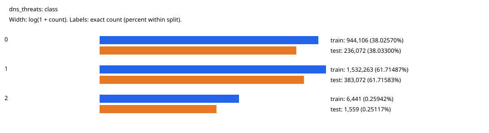
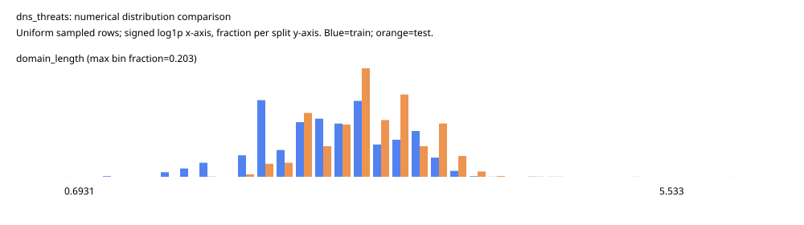

# DNS Threats dataset analysis

Generated 2026-11-15T09:32:40.853059+00:00 (UTC).

## Method and limits

Full-file counts, finite-value moments and Pearson correlations are computed in chunks. Quantiles, histograms and 3×IQR outlier rates use a deterministic uniform priority sample per split (seed 20261115, test +1); they are estimates, not exact population quantiles. Unparseable, missing and infinite values are excluded from finite statistics; finite range violations remain visible in those statistics and are separately flagged. Sample outlier rates are undefined when IQR is zero. Near-constant means ≥99% of all rows have one value. Numerical majority counts use a second exact pass; categorical counts are exact. No rows are modified, dropped, merged into a training dataset, or used to fit a model.

SQLite compares parsed field strings (CSV quoting differences are immaterial), preserving case, whitespace and numeric spelling. BoT-IoT feature vectors use SHA-256 signatures of unambiguous JSON tuples; hash collision risk is negligible but these are signature checks rather than byte-by-byte collision verification. DNS feature keys are exact domain strings. Label conflicts compare the entire label tuple. These checks do not detect near-duplicates, semantically equivalent numeric spellings, or DNS case/trailing-dot equivalence. Cross-split queries join signatures only, not raw datasets.

## Dataset inspection

| Split | Rows | Columns | CSV MiB | String-column memory MiB¹ | Peak chunk MiB¹ | Sample rows |
| --- | --- | --- | --- | --- | --- | --- |
| train | 2,482,810 | 2 | 40.79 | 73.94 | 1.49 | 30000 |
| test | 620,703 | 2 | 12.62 | 20.91 | 1.69 | 30000 |

¹Deep pandas column bytes summed over chunks estimate full string-table memory; peak is one raw chunk only. Excludes Python counters, numeric arrays, sample copies and SQLite cache. Actual process peak RSS is in summary.md.

### train

Source: `data/raw/dns_threats/train_combined_multiclass.csv`. Labels: `class`.

| Column | Observed read dtype | Role / semantic type | Missing | +/−infinity | Invalid¹ |
| --- | --- | --- | --- | --- | --- |
| domain | str | categorical / string | 0 | 0 | 0 |
| class | str | label (categorical) | 0 | 0 | 0 |

CSV has no intrinsic stored dtypes; integer/floating semantics above are inferred across all finite numerical values. All fields are deliberately read as strings to preserve mixed port tokens and duplicate identity. Semantic numerical/categorical roles are above; labels and encoded state/protocol are categorical even when integer-valued. Missing means empty/whitespace; numeric fields also recognize NA/nan/null/none/n/a. Literal domain strings such as 'nan' are not automatically missing.

¹Invalid checks: expected numeric parsing and nonnegative values, IP syntax, port range 0–65535 (hex allowed), and attack∈{0,1}. DNS class codes are only checked as nonnegative integers; their meaning is unverified. DNS lexical flags below are screening observations, not definitive invalidity judgments. No protocol/state dictionary is supplied, so unknown codes cannot be validated. Empty categories are counted as missing.

Validation observations:

| Check | Rows |
| --- | --- |
| class: not nonnegative integer | 0 |
| domain: >253 characters | 0 |
| domain: any label >63 characters | 386 |
| domain: empty | 0 |
| domain: empty interior label | 0 |
| domain: no dot (single label / possibly stripped name) | 2482810 |
| domain: non-ASCII | 0 |
| domain: outside ASCII letters/digits/dot/hyphen/underscore | 0 |
| domain: uppercase | 397 |
| domain: whitespace | 0 |

Constant columns: none (numeric constants use finite values; see missing counts).

No near-constant columns at the 99% threshold.

### test

Source: `data/raw/dns_threats/test_combined_multiclass.csv`. Labels: `class`.

| Column | Observed read dtype | Role / semantic type | Missing | +/−infinity | Invalid¹ |
| --- | --- | --- | --- | --- | --- |
| domain | str | categorical / string | 0 | 0 | 0 |
| class | str | label (categorical) | 0 | 0 | 0 |

CSV has no intrinsic stored dtypes; integer/floating semantics above are inferred across all finite numerical values. All fields are deliberately read as strings to preserve mixed port tokens and duplicate identity. Semantic numerical/categorical roles are above; labels and encoded state/protocol are categorical even when integer-valued. Missing means empty/whitespace; numeric fields also recognize NA/nan/null/none/n/a. Literal domain strings such as 'nan' are not automatically missing.

¹Invalid checks: expected numeric parsing and nonnegative values, IP syntax, port range 0–65535 (hex allowed), and attack∈{0,1}. DNS class codes are only checked as nonnegative integers; their meaning is unverified. DNS lexical flags below are screening observations, not definitive invalidity judgments. No protocol/state dictionary is supplied, so unknown codes cannot be validated. Empty categories are counted as missing.

Validation observations:

| Check | Rows |
| --- | --- |
| class: not nonnegative integer | 0 |
| domain: >253 characters | 0 |
| domain: any label >63 characters | 0 |
| domain: empty | 0 |
| domain: empty interior label | 0 |
| domain: no dot (single label / possibly stripped name) | 46 |
| domain: non-ASCII | 0 |
| domain: outside ASCII letters/digits/dot/hyphen/underscore | 0 |
| domain: uppercase | 80 |
| domain: whitespace | 0 |

Constant columns: none (numeric constants use finite values; see missing counts).

No near-constant columns at the 99% threshold.

## Domain representation and source-artifact risks

Compare domain structure before treating the supplied splits as interchangeable. The last dot-separated token below is a diagnostic suffix, not a public-suffix/registrable-domain parse. Counts are full-file and grouped by observed code without assigning class meanings.

### train

| Class | Rows | No dot % | Mean length | Label >63 chars | Top final tokens |
| --- | --- | --- | --- | --- | --- |
| 0 | 944106 | 100.000000 | 10.2933 | 0 | [('<single label>', 944106)] |
| 1 | 1532263 | 100.000000 | 16.5808 | 0 | [('<single label>', 1532263)] |
| 2 | 6441 | 100.000000 | 30.9247 | 386 | [('<single label>', 6441)] |

### test

| Class | Rows | No dot % | Mean length | Label >63 chars | Top final tokens |
| --- | --- | --- | --- | --- | --- |
| 0 | 236072 | 0.019062 | 14.4025 | 0 | [('com', 100792), ('cz', 36344), ('net', 10283), ('ru', 9227), ('org', 8520)] |
| 1 | 383072 | 0.000261 | 20.5080 | 0 | [('com', 186138), ('org', 46854), ('net', 36196), ('ru', 26978), ('biz', 23763)] |
| 2 | 1559 | 0.000000 | 76.2187 | 0 | [('online', 1224), ('com', 335)] |

A single-label/FQDN mismatch can alter length, dot counts and suffix features while hiding shared underlying names from exact-string overlap checks. Suffixes concentrated in one class may encode collection/generation sources. Verify provenance and define the intended prediction unit before any feature design or trustworthy train/test evaluation. Do not infer independent underlying domains from zero raw-string overlap.

## Class distributions and split comparison

### `class`

| Class | Train n | Train % | Test n | Test % | Test−train pp |
| --- | --- | --- | --- | --- | --- |
| 0 | 944,106 | 38.025705 | 236,072 | 38.033005 | +0.007300 |
| 1 | 1,532,263 | 61.714871 | 383,072 | 61.715829 | +0.000957 |
| 2 | 6,441 | 0.259424 | 1,559 | 0.251167 | -0.008257 |

Classes absent from test: none; absent from train: none. Recall is not measurable for a class with zero test support.

train: minority `2` = 6,441 (0.259424%); majority/minority ratio = 237.89:1. Classes under 1%: 2.

test: minority `2` = 1,559 (0.251167%); majority/minority ratio = 245.72:1. Classes under 1%: 2.

The filename says multiclass, but the actual observed code inventory above defines the available task. No local label dictionary establishes that 0=benign or identifies threat families. Do not invent a binary collapse or code meanings. A binary analysis becomes meaningful only after that mapping is verified.

## Feature distributions and descriptive statistics

Moments below cover every finite value; skew is the population standardized third central moment. Ports are parsed numerically for diagnostics only, while preserving their categorical tokens. Domain length is an analysis-only measurement, not an implemented preprocessing pipeline.

### train

| Column | Finite n | Mean | SD | Min | Max | Skew | Sample p01 / p25 / p50 / p75 / p99 | Sample extreme % (3×IQR) |
| --- | --- | --- | --- | --- | --- | --- | --- | --- |
| domain_length (EDA only) | 2482810 | 14.2272 | 6.81193 | 1 | 65 | 0.920429 | 4 / 9 / 13 / 18 / 34 | 0.0766667 |

Features with |population skew| >2: none. Extreme values are investigation candidates, not automatic removal criteria; attacks may produce legitimate extremes.

### test

| Column | Finite n | Mean | SD | Min | Max | Skew | Sample p01 / p25 / p50 / p75 / p99 | Sample extreme % (3×IQR) |
| --- | --- | --- | --- | --- | --- | --- | --- | --- |
| domain_length (EDA only) | 620703 | 18.3259 | 7.99513 | 4 | 253 | 6.77418 | 7 / 13 / 17 / 22 / 37 | 0.156667 |

Features with |population skew| >2: domain_length (EDA only). Extreme values are investigation candidates, not automatic removal criteria; attacks may produce legitimate extremes.

## Correlations and redundancy

No numerical input columns exist, so input-feature Pearson correlation and numerical feature redundancy are not applicable. Numeric class codes are labels, not predictors. Domain length is only a diagnostic; repeated domain strings are evaluated below.

## Categorical cardinality

### train

| Column | Distinct | Distinct / rows % | Top values: counts |
| --- | --- | --- | --- |
| class | 3 | 0.0001 | 1: 1,532,263; 0: 944,106; 2: 6,441 |
| domain | 2364906 | 95.2512 | [('ns1', 175), ('google', 172), ('www', 113), ('dhl', 58), ('comune', 52)] |

### test

| Column | Distinct | Distinct / rows % | Top values: counts |
| --- | --- | --- | --- |
| class | 3 | 0.0005 | 1: 383,072; 0: 236,072; 2: 1,559 |
| domain | 620696 | 99.9989 | [('1.ekzHnJ4vqvvfDWVLll2HGi5xanng8zxxZLGR4bbtEOhYQS_g3_NsHhci70lFJJk.5BVfEjfExl86zi1lFcr4_N5TBpU2L6mf2w5Isf3QqmwjBcA4c-wRtg-FbbnTNFV.Xr8GTDrOMrm83j7POPKTq4jxFwCaaC6HlxA8-rR-U2_DfdYpEoQG7u1m6hfQLy7.1RfeuAY6u6uwrvMh7NSNjI6Q1vET.securitytesting.online', 2), ('10.9w5iArI2EAJl67WIjI3EY4GvFsHMw-iAeOkpvjZyM_qtd-GM_diC_74SnBaYcf1.80tdU0dDkt_Ncxx-OySqdEiMpOOasu2kONf9FWG3PQ9_Sw63AlPV1hJeykJuhvV.Y4yEUVeC2MryHYtvr0SONsTw2rPJQVnwKi1ulQotZ3XIHTWF-O_E6960PtovkKr.zWIsC6J2elqXv3LuIfJGvJaEAoh7.securitytesting.online', 2), ('20.n-QPs7m4g3wfonTU4dXpyomHwr6ijDGlZkDqCNSZBTodpR0Hy03_p4nIee_iZVb.EQiChTcv5sxuhwTTmgUkJdtF6K0bAAqy1HIj2OZfEXl3PQYNqzzgQLYupiVmsM-.G3PsBv3MngfK-j_qa428AUz06Rc9pE2MTevxMJGIzY-lm80kFJRyJg2cAlNCujz.XP8dZ4-W0lwQAi8JZ906jdaSZQBx.securitytesting.online', 2), ('32.WHXXAbTPUl8P6k4tOUuIxIw9erUyycnFDSU3JgE-VZQka6eqyHOLl6rT71zqpLN.aP3ZAu4Syq-TDBkeDB2e7oz7I20la8CihnKtbcBrvOUf7aqMcfChrlWbTlzJg57._W6ru4xxPxigKIYsGV1PSpyKctFFQ1Qz1Ne4dcivES8yEp7FLR4sZKMtYmq0-oF.tkBzLgrppLiTpp6c071wKzTxHFSH.securitytesting.online', 2), ('42.cSNdm0jlXetMPC6ANpJ9kligP7BieiclU3n-U3F5mTuuH3lSt-nM3qxHHpIerSw._7u4_ei9iuIExpKCTYUarOHXfoMD5I-BMBzkz8GAfZ47uSzbvLUEC1QPC1S54T_.SJ2INvIfg5GSqYLC7hAFv7FhGeO4tZGFXLXpjNOw29hu-ZYJjElBegJX2C162zJ.7tJOE-eoh2cBDYOAc-bf5wESThKt.securitytesting.online', 2)] |

## Duplicate, overlap and conflicting-label audit

Duplicate excess is sum(group size−1); duplicate groups have size>1. Shared groups count distinct (feature vector, complete label tuple) pairs; affected rows are reported separately. Conflicting vectors have more than one complete label tuple. Both splits retain all their rows.

### raw feature view

Features: `domain`. Labels: `class`.

| Measure | Count |
| --- | --- |
| train_duplicate_excess | 117,804 |
| train_duplicate_groups | 70,771 |
| train_conflicting_vectors | 100 |
| test_duplicate_excess | 7 |
| test_duplicate_groups | 7 |
| test_conflicting_vectors | 0 |
| shared_feature_label_groups | 0 |
| train_rows_in_shared_feature_label | 0 |
| test_rows_in_shared_feature_label | 0 |
| shared_feature_vectors | 0 |
| conflicting_vectors_across_splits | 0 |
| conflicting_vectors_any_split | 100 |

### Example conflicting domain labels across the supplied splits

| Domain | Split: label tuple (row count) |
| --- | --- |
| ablenews | train:["0"] (1); train:["1"] (1) |
| ableworld | train:["0"] (1); train:["1"] (1) |
| adeba | train:["0"] (2); train:["1"] (1) |
| afnic | train:["0"] (1); train:["1"] (1) |
| akccs | train:["0"] (1); train:["1"] (1) |

## Passive unidirectional streaming compatibility

| Feature | Available? | Constraints |
| --- | --- | --- |
| domain | Yes, conditional | Plaintext DNS question contains a name in one request direction; no reply, completed connection or future packet needed. TCP DNS may require past-byte reassembly; truncation/fragmentation limits visibility. Encrypted DNS payload names are unavailable to a passive observer without decryption. These files often contain name tokens rather than verified full QNAMEs; representation parity must be established. |
| class | No | Ground truth available only offline; never a live predictor. |

No timestamps, client identities, query types, response codes, TTLs, packet sizes, or response timings are supplied. Do not assume these features can be recovered from this CSV. Absence of capture provenance prevents temporal/family leakage audits.

## Recommended next steps (not implemented)

Resolve the observed train/test domain representation mismatch before model evaluation; do not simply strip suffixes without confirming the target unit and source provenance. Verify the label-code dictionary and source provenance before defining benign/malicious or family tasks. Investigate label conflicts and cross-split domain reuse before considering deduplication; preserve originals. Define a domain normalization policy (IDNA, case, trailing dot, QNAME vs stripped label) based on observed capture representation, then repeat overlap checks. Prefer inexpensive lexical statistics or bounded sparse character n-grams rather than one-hot encoding each domain; all vocabulary/normalization decisions must be fitted or selected using training folds only.

Use domain-grouped training validation; if source/family/time metadata becomes available, add family-held-out and temporal tests. A supplied test score may be inflated by repeated domains or shared generation patterns. Begin with class-weighted sparse linear baselines or small trees on lexical summaries on CPU, after the audit is resolved. Report macro-F1, per-class recall/precision, confusion matrices and uncertainty for rare classes; use PR-AUC only after binary mapping is verified. Sampling/resampling belongs inside training folds, never before validation splitting.
