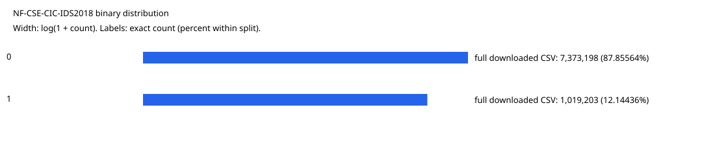
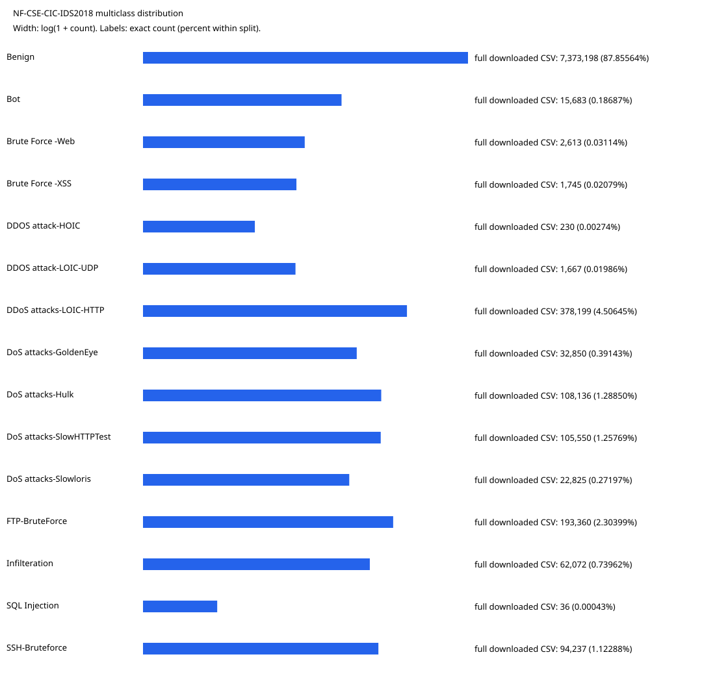

# NF-CSE-CIC-IDS2018: overview

Audit scope: one downloaded CSV, read-only. No model training, preprocessing implementation, partitions, BoT-IoT test access or API/dashboard changes. All numerical counts below come from this download. [Machine-readable evidence](audit.json) includes cross-tabs, examples, run settings and checksums.

## Provenance and integrity

Source: `data/raw/nf-cse-cic-ids2018/88a47ba2ab64258e_MOHANAD_A4706/data/NF-CSE-CIC-IDS2018.csv`. The supplied `bag-info.txt` attributes the bag to the University of Queensland, School of Information Technology and Electrical Engineering, contact/creator Mohanad Sarhan; Bagging-Date 2023-05-11, BagIt 0.96, UTF-8. This is a packaging date, **not capture time**. `FurtherInformation.txt` directs readers to [UQ metadata/licensing](https://espace.library.uq.edu.au/view/UQ:b9ed88b). That page returned HTTP 403 during this audit; licensing and upstream exporter configuration were not independently verified. Local metadata and feature definitions are the evidence used here. No published row counts were substituted.

Manifest validation: **PASS**. 5 declared payload/tag SHA-1 comparisons checked, with exact payload inventory coverage. 7 ZIP files were streamed without extraction; CRC checking and SHA-256/byte-size comparisons against the extracted bag passed: True. Archive bytes: 72,413,856; SHA-256 `e228273211a6eb1cf9e850974104931972b3cc7d4295e079abe11e7f96209079`. The ZIP inventory exactly matches the bag. The supplied tag manifest does not list `FurtherInformation.txt`; its recorded SHA-256 and archive match are additional local consistency evidence, not a supplied manifest check. SHA-1 validates the supplied manifest but is not an authenticity signature. Matching local files cannot prove origin, licensing or label truth. All input SHA-256 hashes were rechecked after the scan; inputs remained unchanged.

| Extracted relative file | Bytes | SHA-1 | SHA-256 |
| --- | --- | --- | --- |
| FurtherInformation.txt | 143 | 815b448069a60fc8529fc74676af396427eba467 | a95d5c14e198c8937f0d8e8cebaeacc2e70d01c6055a2b270bd8a2b608659020 |
| bag-info.txt | 816 | 21ee9a559945183e7144f33bf7d6fb189e5ab99f | 534228ad0b46a862af31b84854d695d4260ec6c97a36271874af000d3ccab4b1 |
| bagit.txt | 55 | a7b95616bf7307fc398baeb04ce60a88ed370f51 | 133dce1caef7fc5544d815791265569a933ec658860821fdff8c157b561d0d39 |
| data/NF-CSE-CIC-IDS2018.csv | 620014585 | 71f0471d915b72635add459d0bd93b463281b183 | ed3387646fda24084889f07788cd22da2978b860f5b3d2d6f1210a4e3d7998e0 |
| data/NetFlow_v1_Features.csv | 491 | 254533e6866a5dc0429c83397af5fc36c4a9a9f8 | 778271c208e0eb0c5de21f43ac6b13dea3e7b78625349fe915b36e6f814bcc39 |
| manifest-sha1.txt | 139 | e38d25bd1e157e394467b9ccf35a3a521818925d | 1f742f2d2e34bda758dd4e4c6d5989cd5866157ee84ff57d12e0a02393bae3dc |
| tagmanifest-sha1.txt | 164 | afe7c526d91c0216ae2e77e00cdf56ea2d954676 | 6f5eefeaa1a6e296c7735663e70b940c9295c80f21ed60bdb9e06ca9571c44df |

## Shape and labels

**8,392,401 rows × 14 columns**, including two labels and 12 candidate predictors (two IP identifiers). CSV bytes: 620,014,585. `Label` and `Attack` are excluded from every predictor view. Both are observed labels, not predictors. The feature dictionary documents only predictors; label meaning is supported by the observed full-file cross-tab: Benign ↔ 0, every other observed Attack ↔ 1. Binary/multiclass disagreement or invalid binary rows: **0**. This verifies internal agreement, not independent ground-truth correctness. Unexpected spellings against the explicit known-name inventory: []. Preserve original names, including `Infilteration`; do not merge or silently fix names.

| Label (verbatim) | Rows | Percent |
| --- | --- | --- |
| 0 | 7373198 | 87.855645% |
| 1 | 1019203 | 12.144355% |

| Attack (verbatim) | Rows | Percent |
| --- | --- | --- |
| Benign | 7,373,198 | 87.855645% |
| DDoS attacks-LOIC-HTTP | 378,199 | 4.506446% |
| FTP-BruteForce | 193,360 | 2.303989% |
| DoS attacks-Hulk | 108,136 | 1.288499% |
| DoS attacks-SlowHTTPTest | 105,550 | 1.257685% |
| SSH-Bruteforce | 94,237 | 1.122885% |
| Infilteration | 62,072 | 0.739621% |
| DoS attacks-GoldenEye | 32,850 | 0.391426% |
| DoS attacks-Slowloris | 22,825 | 0.271972% |
| Bot | 15,683 | 0.186871% |
| Brute Force -Web | 2,613 | 0.031135% |
| Brute Force -XSS | 1,745 | 0.020793% |
| DDOS attack-LOIC-UDP | 1,667 | 0.019863% |
| DDOS attack-HOIC | 230 | 0.002741% |
| SQL Injection | 36 | 0.000429% |

Smallest classes need group-support checks before multiclass claims. These are raw record supports, not independent episodes. The benign population here must not be confused with the 370 benign BoT-IoT training rows; cross-dataset schemas and label meanings differ.

## Resources and reproducibility

Executed with Python 3.13 and existing pandas/NumPy/SQLite, CPU only, no new ML library. Versions: `{'python': '3.13.12', 'pandas': '3.1.1', 'numpy': '2.5.4', 'sqlite': '3.50.4'}`. `uv run python scripts/inspect_nf_cse.py --chunk-size 50000 --sample-size 30000`. Main audit command took 544.55 seconds before report rendering; supplementary diagnostics (if run separately) took 112.03 seconds; Measured main-process peak RSS 345.1 MiB (Linux); supplemental-process peaks were not separately recorded. Measured deep string-column footprint summed over chunks: 1.343 GiB (projection of retaining all token columns, excludes whole-frame/index/allocator overhead). Largest raw chunk 8.3 MiB. Measured SQLite index 1.741 GiB before cleanup. Measurement scope: The 544.55-second main run measured four original views; the duration-free seven-input view was audited separately (97.59 seconds). Graph/duration checks took 14.44 seconds in separate processes; timings are stage durations, not a summed wall-clock benchmark. The separate seven-input index size and supplemental process RSS were not recorded. All indexes were deleted; future combined runs include all five views and may require more disk. Numeric float64 matrix upper estimate for all 10 non-IP predictors: 0.625 GiB; additional encoder/binning/training copies can multiply this. The proposed seven-input float64 matrix alone would require 0.438 GiB before categorical/status fields and fit copies. Labels are not added to that predictor matrix.

Use 25k–50k chunks and at most 30k sampled rows. SQLite has a 64 MiB page cache and disk-backed sorts; budget at least 8 GiB free temporary disk for the combined views/sorts, plus source/archive storage for a rerun (sorts may require extra disk). Temporary DB is removed on success/failure. Full-file moments/counts/duplicate results are exact under the documented token identity; quantiles and correlations use the seeded 30,000-row priority sample and are descriptive only. Sample seed 20261115, independent of chunk boundaries. Runtime/RSS vary; analytical evidence is deterministic. No worker pool/GPU.

16 GB is adequate for this audit. For later training, materialize only selected typed numeric arrays/compact groups, one fit at a time with bounded threads, and measure peak RSS including fit copies; do not keep raw string frames, expanded duplicates and multiple model matrices simultaneously. Initial recommendation: bounded `HistGradientBoostingClassifier` with early stopping disabled unless given a predeclared group-safe inner validation. Scikit-learn is already installed. No LightGBM dependency is installed by this task; a bounded-depth/leaf RandomForest with limited trees and `n_jobs` is a secondary option, likely costlier. No fit has been attempted or timed.

## Status and next steps

**Conditional offline design candidate. NO-GO for live/partial-flow claims or independent deployment-performance claims.** Confirm exporter timing/orientation/units and collect source-session provenance. If integrity failed, unknown labels or schema violations are present, resolve them before training. Freeze the feature and label contract, evaluate group-support feasibility, then authorize preprocessing/splitting/training as a later phase. See [feature audit](feature_audit.md), [quality](data_quality.md), [evaluation design](evaluation_strategy.md), [preprocessing](preprocessing_design.md) and [integration](integration_plan.md). NF-CSE model **not trained**.
