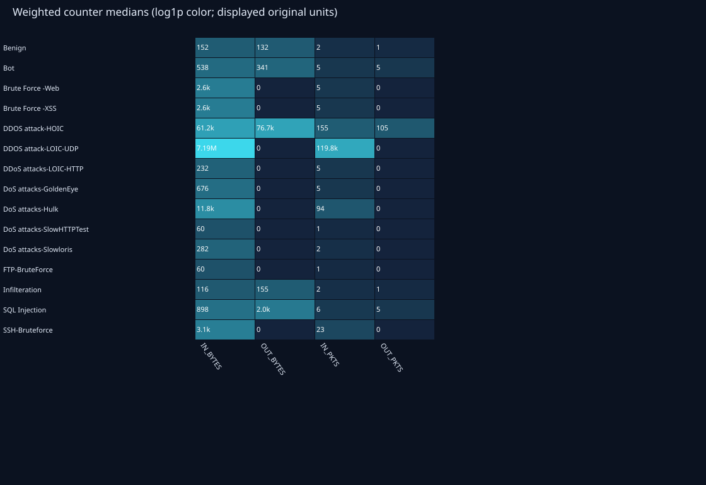
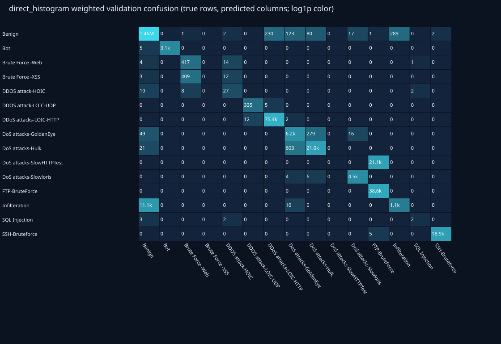
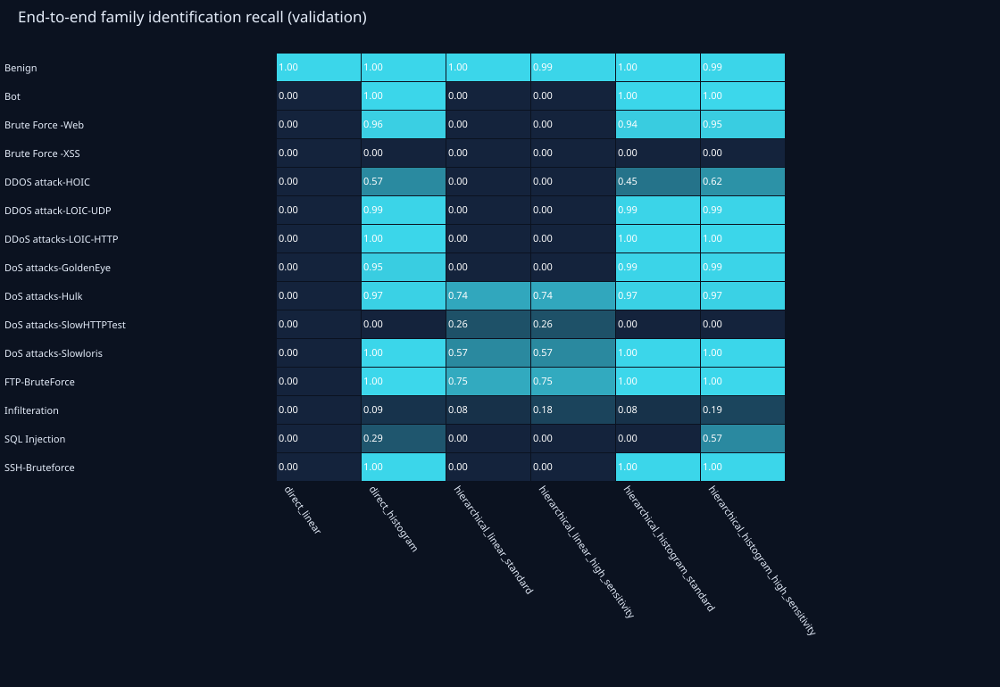

# NF-CSE attack-family feasibility — Phase 7A

## 1. Executive summary

**CONDITIONAL GO.** This is an exploratory offline study of the existing seven completed-flow features, with no production changes or deployment approval. All four predeclared fits and both frozen binary modes are reported. Weighted/macro metrics, benign false positives and family-specific errors determine feasibility; overall accuracy is not the ranking criterion.

The complete full-taxonomy GO requires macro-F1 ≥0.80, benign FPR ≤1%, overall attack detection recall ≥90%, and every attack family's identification recall ≥70% with ≥100 original validation records **and ≥100 distinct validation groups**. Resource gates: cumulative peak RSS ≤12 GiB and study wall time ≤30 minutes. Conditional GO requires detection/FPR/resource gates plus at least half the families meeting the support/recall gates. These engineering criteria were written to [experiment_plan.json](experiment_plan.json) before candidate validation scoring, not fitted to results. They are not claims of deployment adequacy.

[Decision checks](decision.json) list exactly which families pass for each candidate. **Rare-family reliability prevents an unqualified all-family claim.** No categories were merged, oversampled, relabeled or removed.

## 2. Dataset, labels and integrity

The sealed Phase 5B compact NPZ shards already store canonical features, original `Attack` strings, binary `Label`, group IDs and uint64 multiplicities. Labels are recovered directly from these verified shards, not guessed from ports or rejoined to raw data. Benign is index 0; all other names are lexically ordered from training and mapped identically in validation. The original spelling **Infilteration** is retained. Validation-only unseen labels would fail the run.

Every allowed shard checksum was verified before loading and after experiments. Each stored group ID was recomputed from its exact canonical vector, and every vector was checked against the frozen seed/schema partition rule. Full group-ID intersection was empty. [integrity.json](integrity.json) records train/validation hashes, opened-path ledger, manifest, frozen classifier identity and reproducible prediction hashes. Existing `deny_reserved` blocks test-shard opens, class-distribution metadata and processed-data writes. Only train/validation records were read; the common manifest's test objects are skipped by the existing streaming allowlist parser. No raw files, reserved test records or synthetic generator records enter this study.

| Family | Train originals | Validation originals | Train % attacks | Val % attacks | Train compact | Val compact | Train unique/groups | Val unique/groups |
| --- | --- | --- | --- | --- | --- | --- | --- | --- |
| Benign | 4426247 | 1461312 | n/a | n/a | 2626725 | 876995 | 2626725 | 876995 |
| Bot | 9480 | 3148 | 1.5485 | 1.5474 | 8944 | 2958 | 8944 | 2958 |
| Brute Force -Web | 1343 | 436 | 0.2194 | 0.2143 | 91 | 28 | 91 | 28 |
| Brute Force -XSS | 1300 | 424 | 0.2123 | 0.2084 | 48 | 16 | 48 | 16 |
| DDOS attack-HOIC | 135 | 47 | 0.0221 | 0.0231 | 135 | 47 | 135 | 47 |
| DDOS attack-LOIC-UDP | 974 | 340 | 0.1591 | 0.1671 | 974 | 340 | 974 | 340 |
| DDoS attacks-LOIC-HTTP | 227467 | 75369 | 37.1552 | 37.0473 | 29964 | 9878 | 29964 | 9878 |
| DoS attacks-GoldenEye | 19669 | 6587 | 3.2128 | 3.2378 | 19504 | 6532 | 19504 | 6532 |
| DoS attacks-Hulk | 64968 | 21624 | 10.6121 | 10.6292 | 64963 | 21623 | 64963 | 21623 |
| DoS attacks-SlowHTTPTest | 63437 | 21067 | 10.3620 | 10.3554 | 8479 | 2818 | 8479 | 2818 |
| DoS attacks-Slowloris | 13616 | 4546 | 2.2241 | 2.2346 | 10281 | 3380 | 10281 | 3380 |
| FTP-BruteForce | 116120 | 38611 | 18.9674 | 18.9791 | 8479 | 2818 | 8479 | 2818 |
| Infilteration | 37343 | 12292 | 6.0997 | 6.0421 | 34863 | 11573 | 34863 | 11573 |
| SQL Injection | 24 | 7 | 0.0039 | 0.0034 | 24 | 7 | 24 | 7 |
| SSH-Bruteforce | 56331 | 18942 | 9.2013 | 9.3109 | 42523 | 14303 | 42523 | 14303 |

Original counts are sample weights; compact counts describe stored canonical-vector/family rows; unique counts refer to seven-feature vectors. For a given family, unique vectors equal distinct groups by definition. A group can support multiple families. [class_inventory.csv](class_inventory.csv) additionally reports ambiguity counts, own-label shares and multiplicity-weighted majority proportions within ambiguous groups. Multiplicities preserve the source record population but do not create independent episodes. Extremely rare families or families with fewer than 100 validation groups cannot satisfy the reliability gate even if observed recall is high.

## 3. Feature distinguishability

The seven raw inputs are exactly `PROTOCOL,L4_SRC_PORT,L4_DST_PORT,IN_BYTES,OUT_BYTES,IN_PKTS,OUT_PKTS`. Existing canonical-to-13-field value/status encoding is reused unchanged. No IP, duration, capture/row identifier or label is a predictor. Protocol/status fields are categorical for boosting; ports remain numeric following the existing binary baseline. The linear transform reuses fixed protocol/status one-hot categories, port/65535 and log1p counters, with multiplicity-weighted scaling fitted only on the relevant training population.

Full weighted protocol/port distributions were compared, not sampled. The discrete CSVs retain top-10 source ports, destination ports and protocol/source/destination triples per family. [distribution_overlap.csv](distribution_overlap.csv) contains all pairwise total-variation distances for protocol, each port and joint triples (0 = same discrete distribution, 1 = disjoint). Nearest training joint distributions:

| Family A | Family B | Protocol/source/destination joint TV |
| --- | --- | --- |
| DoS attacks-SlowHTTPTest | FTP-BruteForce | 0.029516 |
| Brute Force -Web | Brute Force -XSS | 0.059568 |
| DoS attacks-GoldenEye | DoS attacks-Hulk | 0.276912 |
| DoS attacks-Hulk | DoS attacks-Slowloris | 0.592417 |
| DoS attacks-GoldenEye | DoS attacks-Slowloris | 0.635216 |
| Benign | Infilteration | 0.705808 |
| DDoS attacks-LOIC-HTTP | DoS attacks-Hulk | 0.708676 |
| DDoS attacks-LOIC-HTTP | DoS attacks-GoldenEye | 0.731352 |
| DDOS attack-HOIC | SQL Injection | 0.822222 |
| Brute Force -Web | DDOS attack-HOIC | 0.941921 |

Shared service signatures can make some families inseparable by ports alone; high-cardinality source ports and collection/generation artifacts can also make apparent separation misleading. These comparisons describe this corpus, not causal attack mechanisms. Full seven-feature collisions below provide stronger direct evidence of representation ambiguity.

Counter CSVs contain exact multiplicity-weighted median/p90/p99/means for every family/split. Negative unavailable statuses are excluded from scalar quantiles and counted; zeros remain legitimate values. Cross-feature CSVs report weighted log1p correlations for IN/OUT packets, IN/OUT bytes and directional bytes/packets. Conditioned CSVs report log1p counter means for each family's three most frequent protocols/destination ports. These examine joint relationships without adding new model features. Correlations after zero fill are explicitly descriptive and do not substitute for causal evidence. No outlier clipping occurred.



## 4. Exact feature collisions

| Split | Unique vectors | Ambiguous groups | Min deterministic multiclass errors | Multiclass ceiling | Attack-family conflicts | Benign/attack conflicts | Attack-only ceiling |
| --- | --- | --- | --- | --- | --- | --- | --- |
| train | 2836328 | 19638 | 78223 | 98.447480% | 8635 | 11009 | 89.403747% |
| validation | 946873 | 6435 | 25745 | 98.453523% | 2867 | 3569 | 89.416536% |

For each exact canonical vector, the empirical deterministic multiclass ceiling is `sum(max weighted label mass) / sum(all mass)`. Attack-only ceilings restrict the plurality calculation to attack families; benign/attack and multiple-attack collisions are counted separately and may overlap. No majority voting is applied to training. [feature_overlap.csv](feature_overlap.csv) gives every pair's shared-vector count and label masses. [collision_analysis.json](collision_analysis.json) gives ambiguous population sizes, majority shares and unavoidable disagreement counts.

Specific representation limits in the measured populations are material:

- SlowHTTPTest and FTP-BruteForce share **all** their vectors: 8,479 shared training groups (63,437 SlowHTTPTest / 116,120 FTP records), and 2,818 validation groups (21,067 / 38,611). Both families have substantial weighted support; class scarcity alone cannot explain this indistinguishability. Their protocol/port signatures and seven-field supports overlap exactly. No deterministic function of these inputs can correctly assign both labels for an identical vector.
- SQL Injection shares all 24 training and seven validation vectors with DDOS attack-HOIC, with equal pairwise record masses. This combines representation ambiguity with extremely low SQL support. More copies of identical examples would not resolve it.
- Web and XSS share 1,263 records per label over 11 training vectors, and 410 records per label over two validation vectors. Apparent support is largely correlated multiplicity; the seven fields do not identify which family generated those shared observations.
- Infilteration shares 10,328 training groups with Benign (12,589 Infilteration / 106,923 benign originals) and 3,356 validation groups (3,998 / 29,257). This supplies direct evidence of benign/attack representation ambiguity alongside model misses. It does not prove every remaining error is irreducible.

These observations justify investigating additional independently sourced behavioral context and label provenance; they do not justify silently merging labels. The inventory, pairwise masses and joint distributions support these statements without using the test partition.

These are **empirical lookup ceilings on observed weighted vectors**, not universal generalization bounds, and cannot promise performance on disjoint unseen vectors. Identical vectors with conflicting labels cannot be resolved deterministically from these seven features; incomplete capture/label provenance limits attribution to true attack similarity versus source-label errors.

## 5. Direct multiclass baseline

A linear SGD log-loss baseline and histogram gradient boosting each predict Benign plus all 14 original attack families. No class balancing was used. Both receive original multiplicity sample weights. Linear: five fixed incremental epochs, alpha 1e-4, averaged SGD, deterministic within-batch shuffles. Histogram: 60 boosting iterations, 15 leaves, learning rate 0.1, L2=1, min_samples_leaf=20, early_stopping=False. No model or threshold search occurred. The fixed direct SGD baseline collapsed largely to Benign (attack detection recall about 0.23%); its macro-F1 0.0623 is a poor result for this unoptimized solver/budget, not proof that all linear formulations are infeasible. Attack-only linear macro-F1 was 0.1821. No extra validation-driven solver/epoch experiments were added after observing that outcome. SGD compact weighted gradients are not identical to repeated expanded updates; tree leaf constraints count compact rows. These limitations apply even though the intended objective retains original population weights.

| Candidate | Macro-F1 | Weighted-F1 | Balanced accuracy | Benign FPR | Attack detection recall | Families passing support/recall |
| --- | --- | --- | --- | --- | --- | --- |
| direct_linear | 0.0623 | 0.8207 | 0.0667 | 0.0112% | 0.2296% | 0 |
| direct_histogram | 0.6882 | 0.9716 | 0.7206 | 0.0510% | 94.4804% | 8 |
| hierarchical_linear_standard | 0.1858 | 0.8979 | 0.2266 | 0.0320% | 94.4352% | 2 |
| hierarchical_linear_high_sensitivity | 0.1870 | 0.8942 | 0.2330 | 0.9987% | 95.1072% | 2 |
| hierarchical_histogram_standard | 0.6626 | 0.9717 | 0.6944 | 0.0320% | 94.4352% | 8 |
| hierarchical_histogram_high_sensitivity | 0.6919 | 0.9677 | 0.7508 | 0.9987% | 95.1072% | 8 |

[direct_multiclass_metrics.json](direct_multiclass_metrics.json) and [per_family_metrics.csv](per_family_metrics.csv) contain all per-class precision, recall, F1 and full weighted confusion matrices. Rows are true labels, columns predicted labels in [class_mapping.json](class_mapping.json) order. Undefined precision is zero; fixed-taxonomy macro-F1 includes every class.



## 6. Hierarchical baseline

Stage 1 is the unchanged frozen binary artifact. Both thresholds come from the verified registry configuration, with high_sensitivity cross-checked against frozen artifact metadata: `{'standard': 0.5, 'high_sensitivity': 0.03090052128234102}`. Standard is the existing fixed 0.5 operating point, not a new tuned threshold. Stage 2 trains only on attack-labeled training compact rows, with the same linear/histogram budgets and taxonomy as direct training. No binary refit or calibration.

For final predictions, binary Benign stays Benign; binary Attack routes to a family prediction. Stage-2 predictions on all validation rows were cached once to compare both modes. The report's stage-2 inference timing therefore includes all rows, a conservative bound rather than pretending it measured gated-only inference. Real gated execution would score only routed records; end-to-end validation predictions are identical to that routing. Binary inference separately took 1.17 seconds for the compact validation population. Stage-2 prediction + binary time is a reproducible conservative compute comparison, not request/HTTP latency.

Independent stage-2 evaluation uses true attack-labeled validation rows **without the binary gate**:

| Family classifier | Attack-only macro-F1 | Weighted-F1 | Balanced accuracy |
| --- | --- | --- | --- |
| linear | 0.1821 | 0.2391 | 0.2360 |
| histogram | 0.7494 | 0.8491 | 0.8092 |

Conditional family performance is not end-to-end performance. The table above includes benign rows in every hierarchical final metric/confusion. Family identification recall is the weighted fraction of a true family assigned that exact final family; attack detection recall counts any non-Benign output even when its family is wrong.

| True family | Direct linear recall | Direct histogram precision / recall / F1 | Conditional histogram recall | Hier standard recall | Hier sensitive recall |
| --- | --- | --- | --- | --- | --- |
| Benign | 0.9999 | 0.9924 / 0.9995 / 0.9959 | n/a | 0.9997 | 0.9900 |
| Bot | 0.0000 | 1.0000 / 0.9984 / 0.9992 | 1.0000 | 0.9984 | 1.0000 |
| Brute Force -Web | 0.0000 | 0.4994 / 0.9564 / 0.6562 | 0.9472 | 0.9427 | 0.9472 |
| Brute Force -XSS | 0.0000 | 0.0000 / 0.0000 / 0.0000 | 0.0047 | 0.0047 | 0.0047 |
| DDOS attack-HOIC | 0.0000 | 0.4737 / 0.5745 / 0.5192 | 0.7234 | 0.4468 | 0.6170 |
| DDOS attack-LOIC-UDP | 0.0000 | 0.9654 / 0.9853 / 0.9753 | 0.9853 | 0.9853 | 0.9853 |
| DDoS attacks-LOIC-HTTP | 0.0000 | 0.9969 / 0.9998 / 0.9984 | 0.9998 | 0.9998 | 0.9998 |
| DoS attacks-GoldenEye | 0.0000 | 0.8938 / 0.9478 / 0.9200 | 0.9866 | 0.9860 | 0.9866 |
| DoS attacks-Hulk | 0.0000 | 0.9829 / 0.9711 / 0.9770 | 0.9701 | 0.9698 | 0.9701 |
| DoS attacks-SlowHTTPTest | 0.0000 | 0.0000 / 0.0000 / 0.0000 | 0.0000 | 0.0000 | 0.0000 |
| DoS attacks-Slowloris | 0.0000 | 0.9928 / 0.9978 / 0.9953 | 0.9987 | 0.9987 | 0.9987 |
| FTP-BruteForce | 0.0000 | 0.6469 / 1.0000 / 0.7856 | 1.0000 | 1.0000 | 1.0000 |
| Infilteration | 0.0000 | 0.7989 / 0.0934 / 0.1672 | 0.9985 | 0.0843 | 0.1911 |
| SQL Injection | 0.0000 | 0.4000 / 0.2857 / 0.3333 | 0.7143 | 0.0000 | 0.5714 |
| SSH-Bruteforce | 0.0000 | 0.9999 / 0.9997 / 0.9998 | 0.9997 | 0.9995 | 0.9997 |



## 7. Rare-family diagnosis

| Family | Mode | Support / groups | Detected by frozen binary | Correct family without binary gate | Correct end-to-end |
| --- | --- | --- | --- | --- | --- |
| Brute Force -Web | standard | 436 / 28 | 424 | 413 | 411 |
| Brute Force -XSS | standard | 424 / 16 | 421 | 2 | 2 |
| DDOS attack-HOIC | standard | 47 / 47 | 27 | 34 | 21 |
| Infilteration | standard | 12292 / 11573 | 1037 | 12273 | 1036 |
| SQL Injection | standard | 7 / 7 | 1 | 5 | 0 |
| Brute Force -Web | high_sensitivity | 436 / 28 | 434 | 413 | 413 |
| Brute Force -XSS | high_sensitivity | 424 / 16 | 422 | 2 | 2 |
| DDOS attack-HOIC | high_sensitivity | 47 / 47 | 41 | 34 | 29 |
| Infilteration | high_sensitivity | 12292 / 11573 | 2350 | 12273 | 2349 |
| SQL Injection | high_sensitivity | 7 / 7 | 5 | 5 | 4 |

The binary-detected count isolates first-stage misses; conditional-correct isolates family distinguishability when the binary gate is bypassed; end-to-end-correct requires both stages to succeed. [family_error_decomposition.csv](family_error_decomposition.csv) supplies this breakdown for every family, mode and stage-2 candidate. Compare these counts with collision/support evidence rather than assigning a single unsupported cause.

SQL Injection has only 7 validation records in 7 groups and 24 training records. A one-record change shifts recall by 14.29 percentage points. Even a perfect observed outcome cannot establish reliable rare-family performance. Simple binomial confidence intervals would assume independence not justified by duplicate/grouped traffic; counts and distinct groups are provided instead of false precision. DDOS attack-HOIC also has fewer than 100 validation records. Web/XSS multiplicities and low group support require similar caution.

For Infilteration, the measured histogram stage-2 recall is 12,273/12,292 (99.85%) **conditional on true attack labels**. The standard gate detects 1,037 and yields 1,036 correct final families (8.43%); sensitivity detects 2,350 and yields 2,349 correct final families (19.11%). Sensitive end-to-end Infilteration precision falls to 14.89%, versus 95.40% under standard. Thus conditional success does not cure the binary detection/false-positive problem; excluding benign traffic changes the task materially. Direct histogram family recall is 1,148/12,292 (9.34%). A strong conditional classifier cannot recover flows already predicted Benign by the frozen gate. Conditional failures additionally expose second-stage difficulty. Collision ambiguity is representation evidence; rare/small-group supports are reliability evidence. This study cannot causally separate source-label issues, collection artifacts, missing behavioral features and limited independent episodes. No synthetic examples or validation oversampling were used.

## 8. Exploratory abstention

| Experiment | Raw cutoff | Coverage | Selective accuracy | Selective macro-F1 | Accepted error |
| --- | --- | --- | --- | --- | --- |
| direct_histogram | 0.0 | 100.0000% | 0.9793 | 0.6882 | 2.0682% |
| direct_histogram | 0.5 | 99.9918% | 0.9794 | 0.6441 | 2.0642% |
| direct_histogram | 0.7 | 96.2330% | 0.9926 | 0.5367 | 0.7431% |
| direct_histogram | 0.9 | 96.0714% | 0.9929 | 0.5390 | 0.7086% |
| direct_histogram | 0.95 | 95.7808% | 0.9931 | 0.5399 | 0.6872% |
| family_histogram_standard | 0.0 | 100.0000% | 0.9795 | 0.6626 | 2.0457% |
| family_histogram_standard | 0.5 | 99.9982% | 0.9796 | 0.6589 | 2.0444% |
| family_histogram_standard | 0.7 | 96.2888% | 0.9925 | 0.5387 | 0.7523% |
| family_histogram_standard | 0.9 | 96.2272% | 0.9926 | 0.5408 | 0.7416% |
| family_histogram_standard | 0.95 | 96.1465% | 0.9926 | 0.5414 | 0.7350% |
| family_histogram_high_sensitivity | 0.0 | 100.0000% | 0.9719 | 0.6919 | 2.8132% |
| family_histogram_high_sensitivity | 0.5 | 99.9829% | 0.9720 | 0.6879 | 2.7975% |
| family_histogram_high_sensitivity | 0.7 | 96.2652% | 0.9847 | 0.5379 | 1.5262% |
| family_histogram_high_sensitivity | 0.9 | 96.1939% | 0.9849 | 0.5402 | 1.5068% |
| family_histogram_high_sensitivity | 0.95 | 96.1104% | 0.9850 | 0.5408 | 1.4981% |

Cutoffs 0/0.5/0.7/0.9/0.95 were fixed before scoring. The score is the **uncalibrated maximum class output**, not a calibrated confidence probability. Coverage is accepted original mass / all original mass; selective accuracy and error use only accepted records. Selective macro-F1 uses the fixed taxonomy with undefined/absent classes zero, so it can change when entire families are rejected. It must be read alongside per-family rejection rates/support in [abstention_analysis.json](abstention_analysis.json), not used to hide difficult classes.

Hierarchical abstention applies only to binary-routed attacks; frozen Benign outputs remain accepted and can retain false negatives. Thus high overall coverage/selective accuracy can be dominated by benign traffic. Unknown/Uncertain is an experimental reject outcome, not an additional learned family. At raw cutoff 0.9, direct histogram coverage is 96.07% and accepted accuracy 99.29%, but selective macro-F1 falls to 0.5390: it rejects **all** SlowHTTPTest and FTP-BruteForce validation records, 433/436 Web, 422/424 XSS and 6/7 SQL Injection. High selective accuracy therefore hides substantial loss of attack-family coverage. In the sensitive hierarchy, only 3/12,292 Infilteration records are rejected at 0.9 because most misses remain accepted binary Benign outputs. Simple stage-2 score rejection cannot rescue them. These findings make abstention a potential explicit uncertainty interface for ambiguous families, not a reliable cure or a selected operating point. No final abstention cutoff was selected, no calibration was fitted, and no test access occurred.

## 9. Compute and memory

| Fit | Training seconds | All-validation inference seconds | Compact rows/s | Process peak MiB |
| --- | --- | --- | --- | --- |
| direct_linear | 20.90 | 0.51 | 1866222 | 1942.3 |
| family_linear | 1.67 | 0.54 | 1760391 | 1942.3 |
| direct_histogram | 62.12 | 6.07 | 157008 | 2370.1 |
| family_histogram | 5.25 | 6.13 | 155553 | 2370.1 |

Total analysis/fit/scoring wall time before report rendering: **162.12 s**; cumulative peak process RSS **2370.09 MiB**; 4 CPU threads, Python 3.13. Measurements include compact loading, integrity/collision/distribution work; per-fit peaks are cumulative process high-water marks, not incremental estimator allocations. The binary model was reused rather than retrained; its historical training cost is not included in the new stage-2 fit times. Both new model types use identical fixed budgets in direct/attack-only fits, with naturally smaller attack-only training populations. No GPU or full-row expansion. Chunked probability inference bounds temporary class-score matrices. Resource values vary by machine/load. Four fits are all recorded; there were no undisclosed discarded experiments or validation-based hyperparameter retries.

## 10. Comparative assessment and decision

**CONDITIONAL GO.** Eight families clear the support/recall gates for each boosting architecture: Bot, DDOS attack-LOIC-UDP, DDoS attacks-LOIC-HTTP, DoS attacks-GoldenEye, DoS attacks-Hulk, DoS attacks-Slowloris, FTP-BruteForce and SSH-Bruteforce. None clears the full taxonomy macro-F1 0.80 gate. Web, XSS, HOIC and SQL have insufficient independent group/record support; SlowHTTPTest has zero family recall; Infilteration remains below the family recall gate. This is **NO-GO for a general reliable 15-class deployment now**, with conditional research feasibility for a supported subset. [decision.json](decision.json) evaluates predeclared gates for every candidate. Direct models may jointly distinguish benign and families; hierarchy preserves existing binary operating modes and isolates family learning, but its final recall is capped by binary detection. The standard gate minimizes benign false positives in this corpus; sensitivity trades more false positives for attack coverage. Macro-F1 and rare-family recalls expose weaknesses hidden by weighted scores.

Even if a subset clears the conditional gates, the 15-class taxonomy has insufficient rare-family evidence. Do not deploy/register these experiments or silently merge difficult classes. A useful follow-up would predeclare a supported-family/uncertain-output policy and evaluate it on newly acquired independent captures; additional session/temporal/exporter evidence may be needed to resolve ambiguous families. Any proposed merge must have a defensible semantic rationale before another fit, not merely improve metrics.

## 11. Validation limitations and next steps

The frozen validation partition is group-disjoint, not capture/session/host/time independent. It already informed binary model/threshold selection in earlier phases. This study evaluates four new fits and exploratory abstention on it: comparative findings carry selection/validation-reuse bias. No independent deployment claim follows. The prior binary final-evaluation report was inspected as requested, but its numbers were not used for budgets, taxonomy, thresholds or new candidate selection; no reserved records were opened.

No internal tuning split was needed because all configurations/budgets were fixed. Any future tuning must split training groups only and keep this validation role explicit. The original held-out test benchmark has an existing binary evaluation history; this phase neither reopens it nor resets that history. Collect a new independent evaluation corpus before making broad family-generalization claims.

The generator profiles remain binary and train-derived; they provide no independent family ground truth and were not used as evaluation inputs. Production models, thresholds, API, Streamlit, Simulation Lab, normalizer and processed partitions are unchanged. Experimental estimators are not serialized or registered; predictions/config/metrics/artifact hashes suffice to reproduce this research. Runtime/RSS fields are intentionally non-deterministic. See the root README for the executable, required inputs, output protection and test commands.

## 12. Software verification and reproduction

- Complete project suite: **511 passed in 23.76 s**, including **22 research tests**; the focused research suite passed in **0.46 s**. Tests use synthetic fixtures and do not read real reserved records.
- Coverage: exact label mapping/inventory, weighted support and collision ceilings (including expanded-fixture equivalence), group-disjoint guard, both direct estimator types, hierarchical routing and end-to-end metrics, rare-class counts, abstention, deterministic predictions/figures, checksum-valid semantic corruption, test-path/symlink protections, immutable source guard and output-overwrite refusal.
- Ruff and formatting checks passed; `git diff --check` passed. CLI help and invalid/existing-output behavior were verified. All figures parsed as SVG; confusion/recall plots were rendered and inspected for readable labels.
- Saved confusion matrices, supports, metrics, access ledger and report links were cross-checked. Production classifier hashes match the initial integrity record. No new estimator was deployed or serialized.
- [software_verification.json](software_verification.json) records these execution results. [artifact_manifest.json](artifact_manifest.json) records report/evidence hashes and software identity. Report/figure editorial finalization used existing experiment outputs without any additional fits or scoring.

From the repository root, reproduce into a new directory because existing output is protected:

```bash
uv run python scripts/study_attack_families.py --help
OMP_NUM_THREADS=4 OPENBLAS_NUM_THREADS=4 uv run python scripts/study_attack_families.py --threads 4 --output-dir reports/model_evaluation/nf_cse_attack_family_repeat
uv run pytest tests/unit/test_attack_family_study.py -q
uv run pytest -q
```

The new run reproduces the analysis, fixed fits, figures and metrics. Runtime/RSS depend on the execution environment; software verification records apply to this checked execution and require a separate test run for future revisions.
