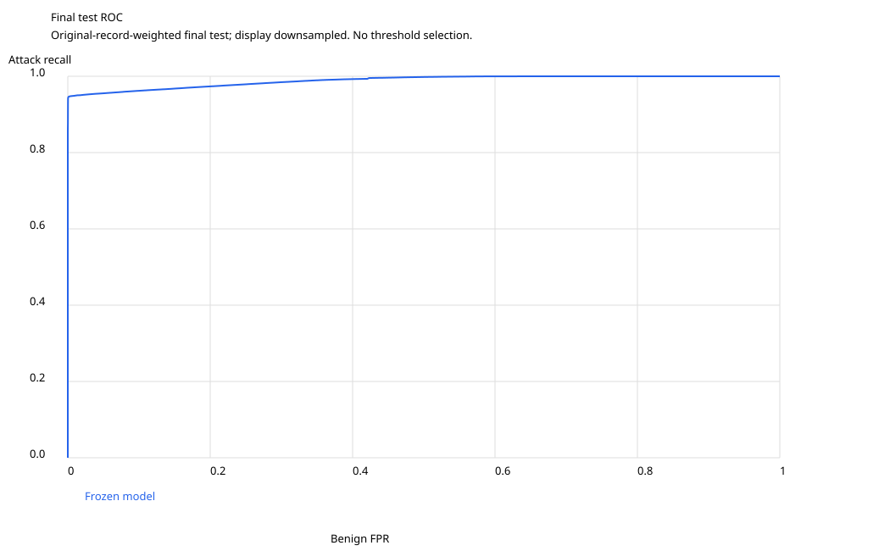
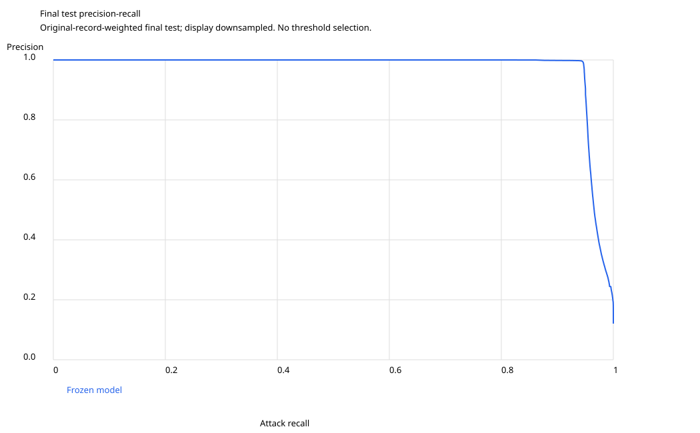
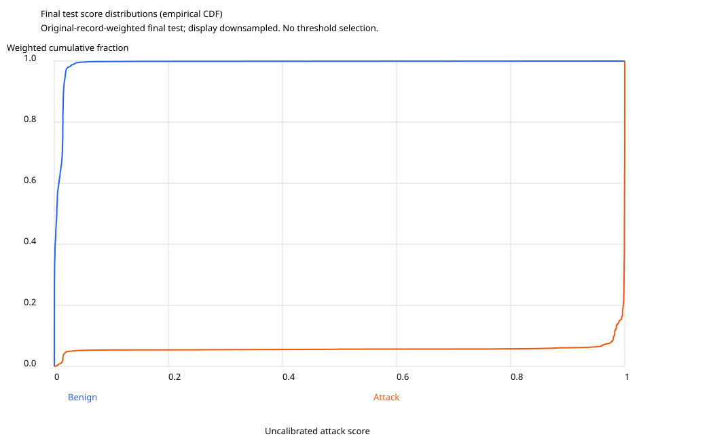
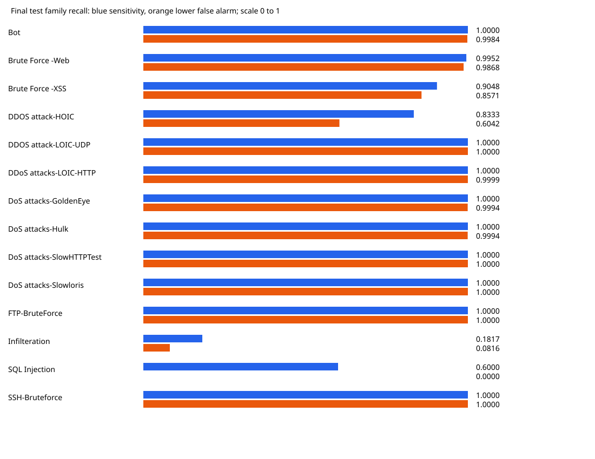

# NF-CSE frozen final test evaluation

FINAL TEST: one frozen evaluation only. Never use these results to tune or calibrate this model; repeated test-based development consumes the benchmark.

Offline completed bidirectional flows only. Feature-group separation does not establish capture/session/host/time independence. Service signatures, collection artifacts, conflicting vectors and exporter parity remain limitations. Scores are uncalibrated; benign predictions do not prove safety. No API/dashboard integration or live/packet-level performance is established.

## Verified population and method

1,689,195 original records represented by 953,681 compact records. Original multiplicities are the only metric weights; conflicting records and all original family names remain. No fitting, calibration, threshold search, class balancing, validation-shard access or raw-data access. Stored canonical vectors use the sealed model encoding directly; they are not re-normalized as raw negative-status values. Synthetic raw probes verify saved inference without fitting.

## Frozen operating points

| Mode | Threshold | Accuracy | Balanced accuracy | Precision | Recall | F1 | Specificity | Benign FPR | FP/10k | Predicted benign | Predicted attack |
|---|---|---|---|---|---|---|---|---|---|---|---|
| high_sensitivity | 0.030900521282341019 | 0.983051 | 0.968757 | 0.912947 | 0.949925 | 0.931069 | 0.987589 | 0.012411 | 124.108212 | 1477394 | 211801 |
| lower_false_alarm | 0.5 | 0.992814 | 0.971563 | 0.996627 | 0.943563 | 0.969370 | 0.999562 | 0.000438 | 4.375222 | 1496477 | 192718 |

high_sensitivity confusion (actual rows / predicted columns, Benign then Attack): `[[1467201, 18438], [10193, 193363]]`; FNR 0.050075.

lower_false_alarm confusion (actual rows / predicted columns, Benign then Attack): `[[1484989, 650], [11488, 192068]]`; FNR 0.056437.

ROC-AUC **0.98861042**; weighted average precision **0.97154343** (step-wise AP, not trapezoidal PR-AUC). Brier **0.00692750**, log loss **0.03628346** with float64 epsilon safeguards. These are uncalibrated-score diagnostics, not calibrated attack probabilities.

## Validation versus final test

Frozen validation metrics JSON is read only; no validation records are scored. Differences below are test minus validation (fractions, not percentage points).

| Mode | Metric | Validation | Test | Difference |
|---|---|---|---|---|
| high_sensitivity | recall | 0.95107157 | 0.94992533 | -0.00114624 |
| high_sensitivity | benign_fpr | 0.00998692 | 0.01241082 | +0.00242391 |
| high_sensitivity | precision | 0.92986351 | 0.91294659 | -0.01691693 |
| high_sensitivity | f1 | 0.94034798 | 0.93106894 | -0.00927904 |
| high_sensitivity | roc_auc | 0.98914734 | 0.98861042 | -0.00053692 |
| high_sensitivity | average_precision | 0.97300749 | 0.97154343 | -0.00146406 |
| lower_false_alarm | recall | 0.94435214 | 0.94356344 | -0.00078870 |
| lower_false_alarm | benign_fpr | 0.00031958 | 0.00043752 | +0.00011795 |
| lower_false_alarm | precision | 0.99757511 | 0.99662720 | -0.00094791 |
| lower_false_alarm | f1 | 0.97023428 | 0.96936968 | -0.00086460 |
| lower_false_alarm | roc_auc | 0.98914734 | 0.98861042 | -0.00053692 |
| lower_false_alarm | average_precision | 0.97300749 | 0.97154343 | -0.00146406 |

## Attack-family weaknesses

| Family | Mode | Original support | Distinct groups | TP | FN | Recall |
|---|---|---|---|---|---|---|
| Bot | high_sensitivity | 3055 | 2910 | 3055 | 0 | 1.000000 |
| Brute Force -Web | high_sensitivity | 834 | 24 | 830 | 4 | 0.995204 |
| Brute Force -XSS | high_sensitivity | 21 | 21 | 19 | 2 | 0.904762 |
| DDOS attack-HOIC | high_sensitivity | 48 | 48 | 40 | 8 | 0.833333 |
| DDOS attack-LOIC-UDP | high_sensitivity | 353 | 353 | 353 | 0 | 1.000000 |
| DDoS attacks-LOIC-HTTP | high_sensitivity | 75363 | 9882 | 75363 | 0 | 1.000000 |
| DoS attacks-GoldenEye | high_sensitivity | 6594 | 6537 | 6594 | 0 | 1.000000 |
| DoS attacks-Hulk | high_sensitivity | 21544 | 21543 | 21544 | 0 | 1.000000 |
| DoS attacks-SlowHTTPTest | high_sensitivity | 21046 | 2819 | 21046 | 0 | 1.000000 |
| DoS attacks-Slowloris | high_sensitivity | 4663 | 3448 | 4663 | 0 | 1.000000 |
| FTP-BruteForce | high_sensitivity | 38629 | 2819 | 38629 | 0 | 1.000000 |
| Infilteration | high_sensitivity | 12437 | 11661 | 2260 | 10177 | 0.181716 |
| SQL Injection | high_sensitivity | 5 | 5 | 3 | 2 | 0.600000 |
| SSH-Bruteforce | high_sensitivity | 18964 | 14322 | 18964 | 0 | 1.000000 |
| Bot | lower_false_alarm | 3055 | 2910 | 3050 | 5 | 0.998363 |
| Brute Force -Web | lower_false_alarm | 834 | 24 | 823 | 11 | 0.986811 |
| Brute Force -XSS | lower_false_alarm | 21 | 21 | 18 | 3 | 0.857143 |
| DDOS attack-HOIC | lower_false_alarm | 48 | 48 | 29 | 19 | 0.604167 |
| DDOS attack-LOIC-UDP | lower_false_alarm | 353 | 353 | 353 | 0 | 1.000000 |
| DDoS attacks-LOIC-HTTP | lower_false_alarm | 75363 | 9882 | 75357 | 6 | 0.999920 |
| DoS attacks-GoldenEye | lower_false_alarm | 6594 | 6537 | 6590 | 4 | 0.999393 |
| DoS attacks-Hulk | lower_false_alarm | 21544 | 21543 | 21531 | 13 | 0.999397 |
| DoS attacks-SlowHTTPTest | lower_false_alarm | 21046 | 2819 | 21046 | 0 | 1.000000 |
| DoS attacks-Slowloris | lower_false_alarm | 4663 | 3448 | 4663 | 0 | 1.000000 |
| FTP-BruteForce | lower_false_alarm | 38629 | 2819 | 38629 | 0 | 1.000000 |
| Infilteration | lower_false_alarm | 12437 | 11661 | 1015 | 11422 | 0.081611 |
| SQL Injection | lower_false_alarm | 5 | 5 | 0 | 5 | 0.000000 |
| SSH-Bruteforce | lower_false_alarm | 18964 | 14322 | 18964 | 0 | 1.000000 |

Infilteration (high_sensitivity): 2,260/12,437 detected; 10,177 misses account for 99.84% of all attack false negatives. This quantifies whether the validation weakness persists; no threshold was changed.

Infilteration (lower_false_alarm): 1,015/12,437 detected; 11,422 misses account for 99.43% of all attack false negatives. This quantifies whether the validation weakness persists; no threshold was changed.

Tiny SQL Injection and other rare-family supports cannot establish robust category detection; weighted repeated records are not independent episodes. Family group counts can overlap because conflicting vectors retain their metadata. This is a binary model, not multiclass attribution.

## Score distributions and interpretation

Weighted empirical CDFs show benign/attack overlap and each original family separately. score_summary.csv records weighted means, counts below each frozen threshold, and counts within ±0.01. Conflicting labels on identical vectors necessarily share scores. The Infilteration TP/FN table and score summary quantify persistence of its validation weakness without changing a threshold. Differences in rare-family row counts and repeated group support can shift measured recall across partitions. Neither these descriptive comparisons nor similar aggregate metrics establish independent capture generalization.

## Resources and reproducibility

Resources: `{"batch_size": 50000, "compact_records_per_second": 637962.0673392987, "peak_rss_mib": 559.16796875, "prediction_seconds": 1.4948866849990736, "serialized_model_bytes": 228278, "threads": 4, "timing_scope": "Integrity, loading, scoring, metrics, plots and rehashes; excludes final markdown/manifest publication.", "wall_seconds": 6.563726153999596}`. Throughput counts compact rows (not independent flows); prediction timing excludes encoding and IO. Peak RSS is process-wide Linux high-water memory. CPU only, no expansion of weighted records. Integrity hashes, software versions, evaluation code/config and UTC timestamp are in evaluation_manifest.json.

The persistent attempt ledger is created exclusively before any test access. Published output is atomic and never overwritten. If an attempt fails, preserve its ledger/staging evidence for manual investigation; there is no routine force/retry path. Inspect existing results read-only. Future improvements require new development data and an independently sourced holdout, not tuning against this final test. No model/service integration is included.

## Post-evaluation review of saved results

This narrative review uses only published metrics/CSVs; no test records were reopened or rescored.

The frozen high-sensitivity threshold **does not retain its validation 1% FPR constraint**: test FPR is **1.241082%**, versus validation **0.998692%** (+0.242391 percentage points). Test attack recall is **94.992533%** versus **95.107157%** (−0.114624 points); precision falls from **92.986351%** to **91.294659%** (−1.691693 points). ROC-AUC decreases by 0.00053692 and AP by 0.00146406. The aggregate ranking measures remain close, while the low-threshold operating point transfers less well. No threshold was adjusted to recover the validation constraint.

At 0.5, test recall is **94.356344%** (−0.078870 points), FPR **0.043752%** (+0.011795 points), precision **99.662720%** (−0.094791 points), and F1 0.96936968 (−0.00086460). Relative to 0.5, the sensitivity point detects **1,295** additional attack records and produces **17,788** additional benign false alarms. These are two predefined operating modes, not a deployment recommendation.

The test score CDFs and score_summary.csv show **33,184 benign** records and **850 attack** records within ±0.01 of the sensitivity cutoff; around 0.5 these counts are 134 and 130. Low-score benign mass makes the sensitivity operating point vulnerable to distribution differences. Frozen validation score distributions were not loaded, so the reason for the FPR shift cannot be causally assigned from this comparison. Capture/session independence and exporter equivalence are unavailable; these results do not resolve those risks.

Infilteration's weighted mean score is **0.104862**, against **0.007858** for Benign and **0.942103** for all attacks. Its **10,177** / **11,422** misses account for **99.84%** / **99.43%** of all attack misses at the two thresholds. Its recall falls from validation 19.12% / 8.44% to test **18.17% / 8.16%**. The weak family discrimination persists despite strong aggregate scores. Feature limitations, label ambiguity and collection effects are plausible hypotheses; this evaluation does not establish their individual causes.

SQL Injection detects **3/5** at sensitivity and **0/5** at 0.5; HOIC detects **40/48** and **29/48**, and XSS **19/21** and **18/21**. These small supports prevent robust family claims. Web has 834 records but only **24 distinct feature groups**. Bot detects 3,055/3,055 and 3,050/3,055; the original DoS/DDoS and brute-force names and supports remain separate in attack_family_recall.csv. High recalls on repeated signatures do not establish effectiveness on novel attacks.

Software verification: **256 tests passed in 8.66 seconds**, including **13 new synthetic final-evaluation tests**. Ruff and formatting checks passed. CLI help, missing-consent refusal, read-only inspection and existing-result refusal were checked. Test scoring ran exactly once; no fitting, threshold optimization, preprocessing, dataset, API or dashboard changes were made. Integrity checks rehashed the frozen model, metadata, normalizer-compatible snapshot and all test inputs after evaluation. The model remains SHA-256 `598129ae5580ad386937f78f4a9d7f8a668557e63cd15db20fcbde9696665e7a`.
