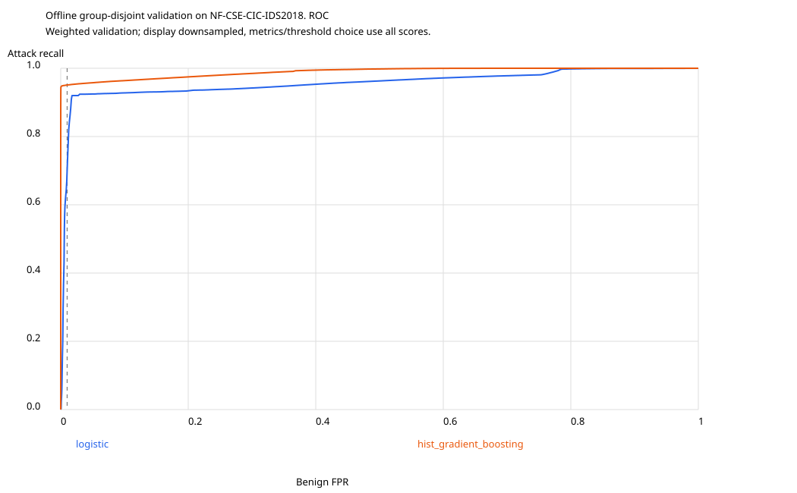
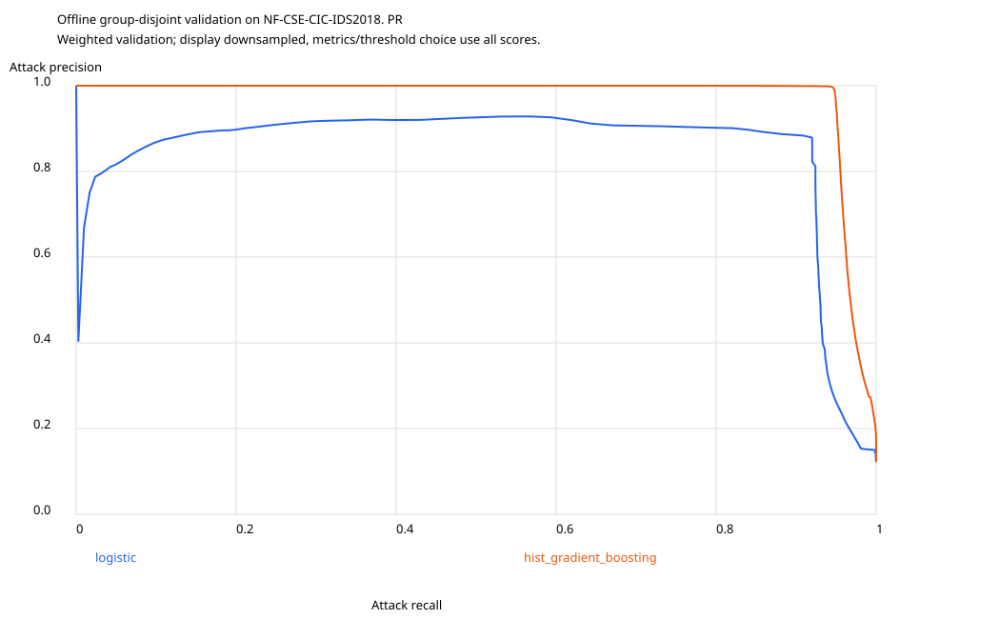
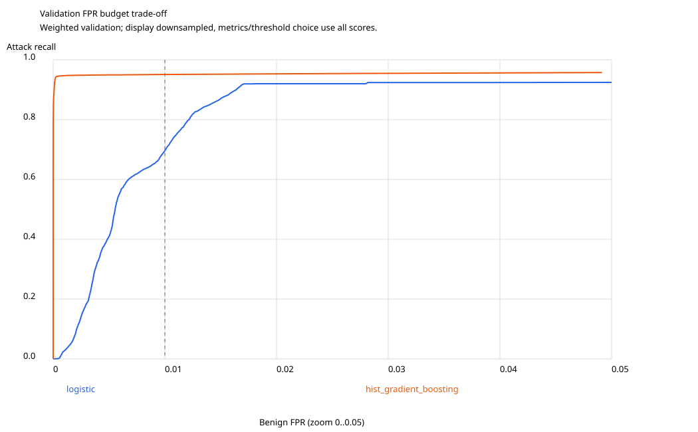
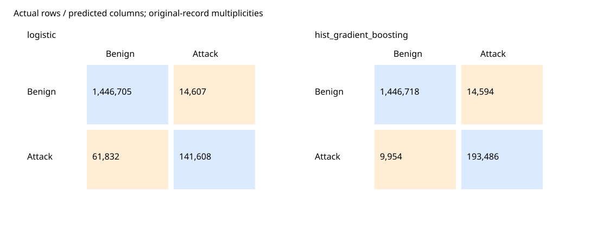
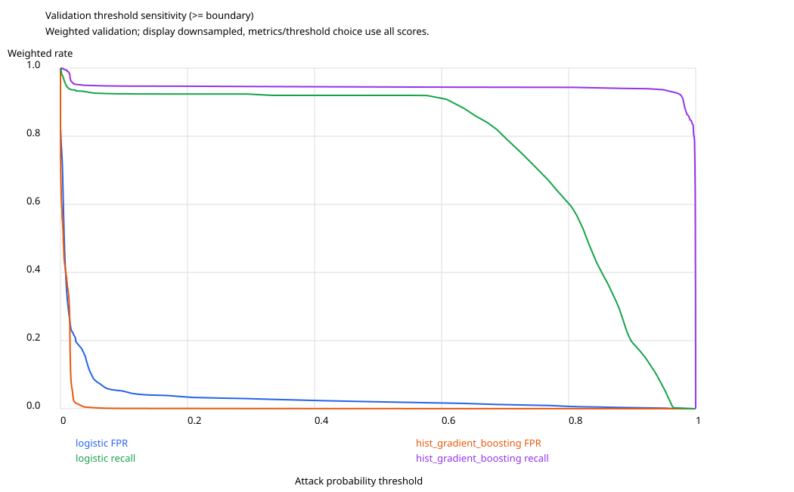
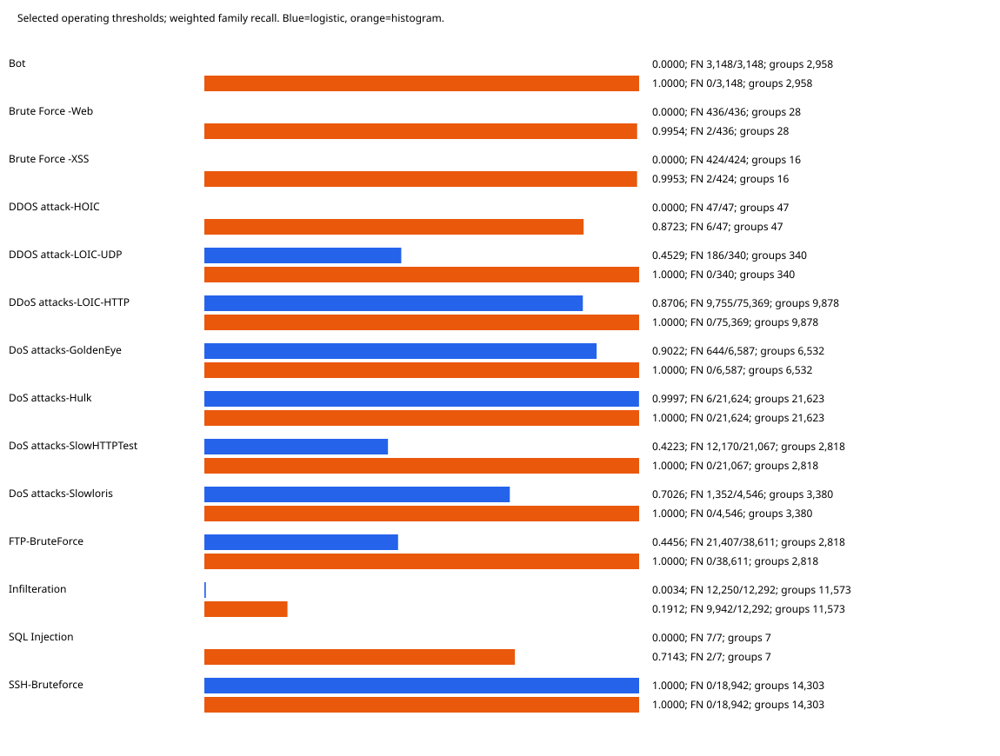

# NF-CSE binary training and validation

**Offline group-disjoint validation on NF-CSE-CIC-IDS2018.** Neither independent-capture nor deployment performance. Reserved test untouched; not integrated into FastAPI or Streamlit.

Selected: **hist_gradient_boosting**, using declared validation-only ranking: attack recall at benign FPR <=1%, then precision, average precision, minimum family recall, CPU throughput and smaller candidate size. Exactly two configured fits, no hyperparameter search, no split regeneration/seed search. The 1% FPR constraint is satisfied on this threshold-selection validation set; it is not an independent false-alarm guarantee.

## Populations, contract and fitting

Model ID `nf_cse_binary_completed_flow`, raw contract `nf-cse-netflow-v1-completed-flow-v1`: `PROTOCOL, L4_SRC_PORT, L4_DST_PORT, IN_BYTES, OUT_BYTES, IN_PKTS, OUT_PKTS`. Seven raw finalized bidirectional-export inputs; IPs, duration, labels, Attack names and identifiers excluded. Existing Phase 5B normalization/model encoding reused, not duplicated. Never normalize stored canonical negative statuses as raw fields. Required field order and preprocessing version are in the artifact. There is no packet, partial-flow or live detection capability. Export orientation, accounting, timeout and cross-exporter parity remain unverified.

Training population: `{'compact_records': 2855997, 'original_record_mass': 5038454, 'binary_mass': [4426247, 612207]}`. Validation population: `{'compact_records': 953316, 'original_record_mass': 1664752}`. Experiment: **Full training partition**. Original multiplicities remain sample weights, retaining conflicting labels and Attack metadata counts. No expansion, vote relabeling, silent deduplication or synthetic benign data. Balancing setting: `False`. Optional balancing multiplies train-only class factors once; estimator class_weight stays None. Validation uses only original multiplicities. Compact rows can change min_samples_leaf and other rules based on unweighted row counts; weighted objectives do not make this identical to expanded fitting.

Logistic: fixed log1p of four counters, port/65535, multiplicity-weighted numeric StandardScaler fitted only on selected training records; fixed protocol/status one-hot categories. No validation fitting. Histogram: Phase 5B's 13 fields, native categorical protocol/status fields, no scaling; early_stopping=False, no internal random-row validation. Thresholds/probabilities are uncalibrated.

Config: `{'balance_classes': False, 'logistic': {'C': 1.0, 'max_iter': 200, 'tol': 0.0001}, 'hist_gradient_boosting': {'max_iter': 150, 'max_leaf_nodes': 31, 'learning_rate': 0.1, 'l2_regularization': 1.0, 'min_samples_leaf': 20}}`; seed 20261115; CPU threads 4. [Detailed metrics/config/provenance](validation_metrics.json).

## Validation metrics

| Model | Operating point | Threshold | Accuracy | Balanced accuracy | Precision | Attack recall | F1 | Benign FPR | FP / 10k benign | ROC-AUC | Average precision |
| --- | --- | --- | --- | --- | --- | --- | --- | --- | --- | --- | --- |
| logistic | fixed_0_5 | 0.5 | 0.972419 | 0.949863 | 0.863281 | 0.920011 | 0.890743 | 0.020285 | 202.845115 | 0.956449 | 0.846799 |
| logistic | selected | 0.7545034151200577 | 0.954084 | 0.843036 | 0.906494 | 0.696068 | 0.787466 | 0.009996 | 99.958120 | 0.956449 | 0.846799 |
| hist_gradient_boosting | fixed_0_5 | 0.5 | 0.992919 | 0.972016 | 0.997575 | 0.944352 | 0.970234 | 0.000320 | 3.195758 | 0.989147 | 0.973007 |
| hist_gradient_boosting | selected | 0.030900521282341019 | 0.985254 | 0.970542 | 0.929864 | 0.951072 | 0.940348 | 0.009987 | 99.869159 | 0.989147 | 0.973007 |

Confusion order is actual rows/predicted columns `[Benign, Attack]`. CSVs distinguish both models and both operating points. Average precision is weighted sklearn average_precision_score (step-wise AP), **not trapezoidal PR-AUC**. All aggregate/family metrics use original-record weights, not training class weights. Selection is an empirical validation constraint, not calibrated probabilities or generalization confidence. A Normal/Benign prediction does not prove safety against unknown threats.

## Thresholds and family weaknesses

Scores >= selected threshold predict Attack. The exact full weighted ROC sweep selects maximum attack recall subject to FPR <=0.01; ties use lower FPR then higher threshold. Equal scores are indivisible. Reject-all uses nextafter(1,+infinity), a finite threshold above every probability, if necessary. Fixed 0.5 results are reported separately. Curves/threshold CSV are bounded display subsets of actual full-data points; numerical AUC/AP and selected threshold use all predictions.

| Attack family | Validation records | Distinct groups | False negatives | Selected-model recall |
| --- | --- | --- | --- | --- |
| Bot | 3148 | 2958 | 0 | 1.000000 |
| Brute Force -Web | 436 | 28 | 2 | 0.995413 |
| Brute Force -XSS | 424 | 16 | 2 | 0.995283 |
| DDOS attack-HOIC | 47 | 47 | 6 | 0.872340 |
| DDOS attack-LOIC-UDP | 340 | 340 | 0 | 1.000000 |
| DDoS attacks-LOIC-HTTP | 75369 | 9878 | 0 | 1.000000 |
| DoS attacks-GoldenEye | 6587 | 6532 | 0 | 1.000000 |
| DoS attacks-Hulk | 21624 | 21623 | 0 | 1.000000 |
| DoS attacks-SlowHTTPTest | 21067 | 2818 | 0 | 1.000000 |
| DoS attacks-Slowloris | 4546 | 3380 | 0 | 1.000000 |
| FTP-BruteForce | 38611 | 2818 | 0 | 1.000000 |
| Infilteration | 12292 | 11573 | 9942 | 0.191181 |
| SQL Injection | 7 | 7 | 2 | 0.714286 |
| SSH-Bruteforce | 18942 | 14303 | 0 | 1.000000 |

Family metadata is validation-only and never a predictor. Small or repeated supports (notably SQL Injection) cannot establish independent family performance. Family recall may reveal severe weaknesses despite high aggregate recall/accuracy; preserve those failures, do not change categories or seeds. All-family results for both thresholds/models: [attack_family_recall.csv](attack_family_recall.csv).

## CPU, timing and artifact

| Model | Fit seconds | Process peak MiB at fit | Validation score seconds | Compact records/s | Amortized ms/record | Raw probe median / p95 ms | Warnings |
| --- | --- | --- | --- | --- | --- | --- | --- |
| logistic | 6.520 | 2153.9 | 0.381 | 2502364.3 | 0.000400 | 9.9979 / 10.4653 | [] |
| hist_gradient_boosting | 14.018 | 2153.9 | 1.379 | 691208.3 | 0.001447 | 13.8651 / 15.3590 | [] |

Timing excludes shard disk IO for validation scoring, uses batches of 50000, and counts actually scored **compact records**, not weighted row mass. Raw single-record latency uses 50 repeated synthetic software probes of a preloaded model, not a production latency benchmark. Process peak is cumulative Linux ru_maxrss, not isolated per-estimator memory. Total resources: `{'wall_seconds': 30.76100351200148, 'peak_rss_mib': 2153.94140625, 'timing_scope': 'Through fitting, validation, serialization and fresh-process verification; excludes report rendering/publication.'}`. CPU only, models fit sequentially, no GPU or cross-validation. Saved artifact 228,278 bytes; SHA-256 `598129ae5580ad386937f78f4a9d7f8a668557e63cd15db20fcbde9696665e7a`. Runtime/dependency/code differences can affect fits and timings.

Source dataset SHA-256 `ed3387646fda24084889f07788cd22da2978b860f5b3d2d6f1210a4e3d7998e0`; sealed partition manifest SHA-256 `1eda7639ceb8e37ab4da75c80c7d209557a9bfb35cb8ccbaea8f7a49299201ce`. Training timestamp `2026-11-15T15:21:56.601151+00:00`. Library versions `{'python': '3.13.12', 'sklearn': '1.9.1', 'numpy': '2.5.4', 'pandas': '3.1.1'}`. Metadata and checksum accompany trusted joblib; only deserialize trusted local files. Selected artifact includes frozen normalization, any fitted LR transforms, estimator, class mapping, threshold and provenance. Both candidate predictions were validation-only; selected scores were checked after serialization. Fresh Python process verification: `{'software_verification_only': True, 'feature_contract_version': 'nf-cse-netflow-v1-completed-flow-v1', 'selected_threshold': 0.03090052128234102, 'predictions': [0, 0], 'labels': ['Benign', 'Benign'], 'probabilities_Benign_Attack': [[0.9990053514203597, 0.0009946485796402205], [0.9998954047668431, 0.00010459523315685877]], 'normalizer_fit_not_called': True}`. Synthetic inputs validate software only, never accuracy.

## Test boundary and limitations

Blocked by the training-process audit hook; no test shard, class_distribution.json or test evaluation object is loaded. Common manifest test objects are skipped without JSON decoding. The shared manifest is hashed as opaque bytes; only train/validation entries and common contract/provenance are decoded. The dedicated loader rejects any partition other than train/validation. Train/validation input files were rehashed after use. No raw datasets opened, no processed files modified, no BoT/DNS fitting and no API/dashboard edits. Validation is not used for final fitting. Selected thresholds/model use validation, so reported results are selection-set estimates; the reserved test remains for a later explicitly authorized frozen evaluation. No test performance is reported here.

Group separation prevents identical retained inputs crossing the frozen split; it does not establish capture/session/host/time independence. Generation/service artifacts, label ambiguity, related flows and unobserved attacks remain risks. Obtain independent captures and exporter parity before deployment claims. Integration requires separate NF schema/model registry/frontend work; the existing three-field/four-class BoT endpoints cannot serve this artifact by swapping file paths.

Run `uv run python scripts/train_nf_cse.py info` to inspect the trusted selected artifact; `uv run python scripts/train_nf_cse.py verify` repeats synthetic software checks. Full training command/config and test commands are documented in the root README. Software test results for this run are appended after regression checks.

## Observed operating trade-off and principal weakness

The selected histogram model follows the predeclared recall-at-FPR<=1% objective, rather than maximizing accuracy or F1. At threshold 0.5 it detects 192,119 attacks with 467 benign false positives. At the saved threshold **0.03090052128234102**, it detects 193,486 attacks with 14,594 benign false positives: **1,367 additional detections cost 14,127 additional false positives** on this validation population. Attack recall improves from 94.435214% to 95.107157%, while benign FPR rises from 0.031958% to 0.998692% and precision falls from 99.757511% to 92.986351%. F1 also falls (0.970234 to 0.940348). The saved threshold is the requested constrained-recall choice, **not a deployment recommendation**; choosing a different operational cost trade-off needs an explicitly documented policy and independent evidence. No additional real-data fit or threshold objective was tried after seeing these results.

**Infilteration is the dominant failure:** only 2,350/12,292 records detected (19.118126% recall), with 9,942 false negatives—9,942 of the model's 9,954 total false negatives. Its observed miss rate should not be obscured by near-perfect recall on several high-volume families. SQL Injection is 5/7 detected (71.43%) and HOIC 41/47 (87.23%); those small validation supports do not establish robust family generalization. Web/XSS high row recalls also rely on only 28/16 distinct feature groups. Labels are preserved; these misses do not justify silently relabeling records or increasing their support with synthetic examples.

The histogram model improves recall at the FPR constraint from logistic regression's 69.606764% to 95.107157%, with higher selected-point precision (92.986351% vs 90.649425%) and AP (0.973007 vs 0.846799), and fewer zero-recall families. Logistic is smaller/faster, but these later ranking factors do not override the declared detection priority. Both fits converged/completed without recorded warnings: logistic used 25 LBFGS iterations and histogram used all 150 configured iterations with early stopping disabled.

## Completed software and integrity checks

- Full regression command: `UV_CACHE_DIR=/tmp/cyberguard-uv-cache uv run --frozen --offline pytest -q` **243 passed in 7.05 seconds**. Eight focused NF-CSE cases cover weighted metrics versus expanded software fixtures, threshold ties/boundaries, weighted train-only scaling, fixed-seed fits/class weights, blocked test/data writes, filtered metadata decoding, shard/schema integrity, serialization/metadata and fresh-process inference. Fixtures are not model-quality evidence.
- Training used all 2,855,997 compact train records representing 5,038,454 original records. Validation used all 953,316 compact records representing 1,664,752 originals. No development sample was used.
- Access ledger contains 81 distinct processed paths: 58 train shards, 20 validation shards, shared manifest + sidecar and common feature contract. **Zero test shard/class-distribution paths**. No test label/family objects were decoded from the common manifest. All allowed shard hashes and the manifest were rechecked; there were no processed-data writes.
- Confusion matrices conserve all 1,664,752 original validation records, with 1,461,312 benign and 203,440 attacks. Family supports/false negatives sum exactly to the attack population/confusion totals. Aggregate AP/ROC metrics use full weighted predictions; bounded plot/CSV display points do not control threshold choice.
- Six SVGs parsed successfully, and report tables/local links were checked. Ruff and formatting checks passed. Documented help/train-help/info/verify commands were executed. Fresh-process verification loaded the trusted artifact and returned aligned `[Benign, Attack]` probabilities and threshold-based numeric/name predictions on synthetic completed-flow inputs; no fit occurs during inference.
- Selected artifact: `models/network/nf_cse_binary_completed_flow.joblib` (**228,278 bytes**, about 222.93 KiB), with adjacent checksum/config metadata. Training fit times were **6.52 s logistic / 14.02 s histogram**; measured run time through fresh-process verification **30.76 s**, cumulative peak RSS **2,153.94 MiB** at four threads. These are observations on this machine, not performance guarantees.
- Existing BoT-IoT artifact still hashes to `93b744ada3af044e2d0e7d4dd6d5fa70870536e7a972443c806a232ce9052c6f`. No retraining, DNS changes, reserved-test evaluation, API routing or dashboard changes occurred. No training blocker remains; deployment and independent-generalization limitations above remain unresolved.
