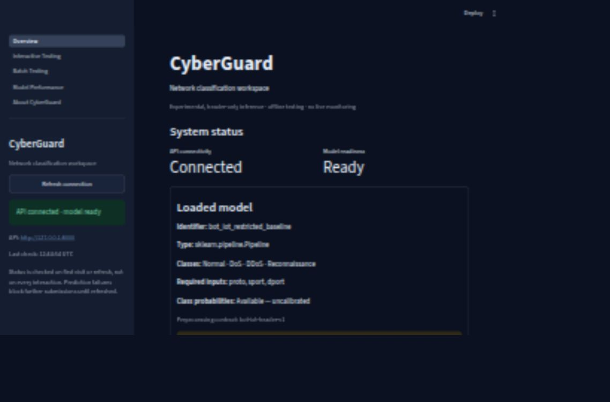

# Phase 4B — Streamlit dashboard

Completed and verified on 2026-11-15 (Asia/Kolkata). This is a local HTTP inference/testing workspace for the existing restricted network classifier. It does not monitor traffic or verify attacks.

## Implemented

- Five native Streamlit pages: Overview, Interactive Testing, Batch Testing, Model Performance and About CyberGuard. Dark theme, responsive layouts, explicit status/error states, Plotly charts and accessible text/count tables.
- A reusable HTTP-only client with `CYBERGUARD_API_URL`, a 10-second request timeout, bounded JSON responses, validated request/response schemas, sanitized errors and no automatic retries. Streamlit never imports an estimator loader or duplicates feature normalization.
- Actual API health/readiness/model metadata, with first-visit and explicit refresh checks instead of polling on widget interactions. Prediction failures clear results and block subsequent submissions until refresh. Loaded model identity is compared with historical artifact SHA-256 when available.
- Single-record testing with common/custom protocols, unchanged port tokens and explicit JSON null values. Results include the actual model class, submitted input, model identifier, optional uncalibrated probabilities and limitations.
- Strict UTF-8 CSV uploads, in-memory only, bounded at 5 MiB and 20,000 records. Required columns are `proto,sport,dport`; additional fields are retained locally and in export. Duplicate/empty headers, output-name collisions, empty files, malformed quoting/widths, NUL bytes, invalid UTF-8 and size/count excesses fail explicitly. Invalid feature *tokens* remain inputs to the existing backend preprocessing statuses; invalid CSV structure is rejected.
- Ordered batch inference in requests of `min(server-advertised maximum, 250)`, using the batch endpoint's OpenAPI request schema. Progress and complete-only result/export behavior; no dropped records or partial success export. Repeated strings remain separate input records.
- Prediction counts/percentages, a paginated feature/prediction table and complete CSV downloads. Formula prefixes in both untrusted headers and cells are escaped on export only. Raw previews/results deliberately use tables without native dataframe CSV exports, preventing an alternate unescaped download path. An explicitly labeled four-record synthetic example is available for software demonstration only.
- Historical JSON/CSV report loading with matching labels, confusion counts, supports, finite bounded metrics and benign denominators checked for consistency. Offline pages remain available without API/model/raw datasets. No metrics are regenerated. Displays include macro-F1, balanced accuracy, benign FPR, per-class recall/precision/F1/support, exact and row-normalized confusion charts, and logarithmic class-support visualization.
- An any-cwd uv launcher, direct Streamlit entrypoint support, `.env.example`, updated root README, and unit/UI tests. No additional dependency or backend endpoint changes were needed.

## Files created or implemented

| File | Purpose |
| --- | --- |
| `src/cyberguard/dashboard/app.py` | Entrypoint, native navigation, configuration and connection/session state |
| `src/cyberguard/dashboard/api_client.py` | HTTP transport, schemas, metadata and bounded ordered chunking |
| `src/cyberguard/dashboard/batch.py` | Bounded CSV parsing, complete result assembly and safe CSV export |
| `src/cyberguard/dashboard/report_loader.py` | Historical JSON/CSV parsing and consistency checks |
| `src/cyberguard/dashboard/ui.py` | Shared unavailable/error/report UI behavior |
| `src/cyberguard/dashboard/components/charts.py` | Probability, performance, confusion and support charts |
| `src/cyberguard/dashboard/components/metrics.py` | Historical metric cards, methodology and capability boundaries |
| `src/cyberguard/dashboard/pages/overview.py` | Real service/model status and historical summary |
| `src/cyberguard/dashboard/pages/test_lab.py` | Single-record HTTP testing |
| `src/cyberguard/dashboard/pages/batch_testing.py` | Upload, preview, progress, complete results and download |
| `src/cyberguard/dashboard/pages/model_performance.py` | Historical charts and imbalance/methodology warnings |
| `src/cyberguard/dashboard/pages/about.py` | Architecture, limitations and existing local documentation |
| `scripts/start_dashboard.sh` | Cwd-independent localhost launcher and dependency checks |
| `.streamlit/config.toml` | Dark theme, localhost:8501, upload bound and disabled usage telemetry |
| `.env.example` | Add dashboard `CYBERGUARD_API_URL` configuration |
| `tests/unit/test_dashboard.py` | Mocked HTTP, CSV, report and Streamlit AppTest coverage |
| `README.md` | Current status, launcher table, setup/configuration, page workflows, limits and troubleshooting |
| `reports/phase4b_dashboard.md` | This completion record |
| `reports/phase4b_dashboard_overview.png` | Browser verification screenshot |

Existing empty live-monitor/alert-history components remain unimplemented and are not in dashboard navigation. Earlier uncommitted API/CLI/README/AGENTS work was preserved. The permanent README-maintenance instruction was already present in `AGENTS.md` and remains intact. Phase 4B did not change `pyproject.toml`, `uv.lock`, backend endpoints, inference logic or preprocessing.

## Automated verification

- Complete suite: **172 passed in 2.96 seconds**, comprising the prior 111 tests plus 61 dashboard tests. The final full run followed the final UI/export changes and malformed-metadata/response-bound regression checks.
- Dashboard tests need no running backend. Mocked HTTP verifies configuration, readiness/metadata/OpenAPI parsing, timeouts, HTTP errors, invalid response/probability handling, null/string preservation, input rejection before transmission, batch bounds/order/progress, incomplete results, changed model identifiers and failure without retry/partial return.
- CSV tests verify schema/encoding/width/quoting, empty input, size/count bounds, extra-field/token preservation, complete output and spreadsheet formula protection for headers/cells.
- Report fixtures verify exact axes/counts/supports, row normalization, logarithmic support plots, missing/inconsistent artifacts and a whitelist of report-only file access. Import/source checks reject estimator/preprocessor imports and raw-data access in dashboard code.
- Streamlit AppTest verifies disconnected pages, blocked submission controls, historical charts, successful mocked predictions/downloads and explicit refresh without repeated status polling. The entrypoint refresh test executes its contents via `from_string` because this Streamlit AppTest version rediscovers the legacy sibling `pages/` directory between callable-page runs; file-based execution was separately verified in the real browser.
- Ruff lint/format checks passed for dashboard code and its tests. Bash syntax checks passed for both launchers.
- The initial restricted-sandbox full-suite attempt could not complete FastAPI TestClient's socket/thread wakeups. The unchanged complete suite passed with normal local socket support; no tests or protections were disabled.

## Browser and real-backend verification

1. Started the API and dashboard launchers by absolute path from `/tmp`. The dashboard served localhost:8501, the API localhost:8000. Also verified the documented direct command `uv run streamlit run src/cyberguard/dashboard/app.py`, including package imports without the launcher's `PYTHONPATH` setup.
2. Verified all five pages in the browser. Overview displayed actual readiness, `bot_iot_restricted_baseline`, `sklearn.pipeline.Pipeline`, all four supported classes, three required features, available probabilities, and a matching historical artifact hash. Reviewed narrow/mobile and desktop layouts, including the collapsible sidebar.
3. Submitted `TCP,49152,80` interactively: the actual API returned **DDoS**, with the submitted input and probability chart shown. This is a software demonstration, not independent labeled evidence.
4. Uploaded an actual four-record CSV through the browser, including an extra `note` column with `=1+1` and ICMP sentinel `-1`. Preview retained exact tokens. Completed ordered predictions were **DDoS, Normal, Reconnaissance, Normal**. Downloaded the result and verified all four rows/order; the formula cell became `'=1+1` and exported sentinel `'-1`, while the preview retained original values.
5. Verified historical summary values read from artifacts: macro-F1 **67.53%**, balanced accuracy **74.20%**, benign FPR **15.19%**, validation records **582,821**. Per-class metrics, exact confusion counts, row percentages and logarithmic supports rendered correctly. The Normal denominator is only **79**, with 12 false positives; these are historical internal validation results, not live or final-test scores.
6. Stopped FastAPI, then submitted another batch. The failed request cleared prior results, displayed unavailable status and disabled further inference. Model Performance remained usable, including confusion normalization, without the backend.
7. Restarted FastAPI with `CYBERGUARD_MAX_BATCH_SIZE=2`, refreshed the connection and recovered readiness. The page displayed the new two-record maximum. Four demonstration records then completed through **two actual batch requests of two records**, confirmed in backend logs, preserving all four predictions in order.
8. Stopped verification servers cleanly after checks. Start them using the README commands when needed.

## Integrity and evaluation boundaries

Before/after SHA-256 comparisons match for all four raw CSVs, the fitted model and the split manifest. The five recorded training/preprocessing source hashes also match the baseline metrics artifact. Raw files were read only as bytes for integrity hashing; the dashboard never opens them. The official test split was neither parsed for inference nor evaluated. No DNS model, fitting, tuning, oversampling or metric regeneration occurred.

| Artifact | Unchanged SHA-256 |
| --- | --- |
| BoT-IoT training CSV | `047e577cd9c7f8f61d44ac170114497904c33091bf80d1dd5e682e353a69c15b` |
| BoT-IoT official test CSV | `8617de2ac5d6ca4c2f77272c7409253a396f2a9e667c29c8e797ab9f57a1868e` |
| DNS training CSV | `42de9f7bbbed2dc09512a1f8302c67e5ef827987edaae78770ad034eeddc2dd8` |
| DNS test CSV | `7343e18f861f9eb6ede5eb4de478ae00cd023e5676093eaba20df611ede42010` |
| Restricted baseline model | `93b744ada3af044e2d0e7d4dd6d5fa70870536e7a972443c806a232ce9052c6f` |
| Split manifest | `d992d69683082595823adb269fb1fa6f2a43664d00c810fddbfc1e7a4fbe3b2d` |

## Known limitations and next phase

The classifier is header-only, closed-set and uncalibrated. Normal does not establish safety; DDoS does not establish that an attack occurred. Theft/unknown attacks and DNS classification remain unsupported. Extreme benign scarcity, repeated capture records and service/exporter artifacts restrict what internal validation can establish.

Connection status is a timestamped snapshot; outages are detected by refresh or a failed request, with no background monitoring. HTTP timeouts apply per request, not to an entire upload; large allowed uploads can require many sequential requests. Multiple requests are not a transaction: do not replace the server model during a batch. A changed returned model identifier is rejected, but replacing weights under the same identifier is not detected until metadata is refreshed. CSV spreadsheet escaping intentionally changes exported token spelling, so a download is not an exact machine-input round trip.

This localhost application has no authentication, alert storage, capture, replay or workers. No requested Phase 4B implementation blocker remains. Recommended next work is a separately scoped causal feature/replay contract and independently sourced, session-separated benign/attack evaluation before any live-monitoring or deployment claim. Additional dashboard statistics should wait for real, validated event sources. See the [README](../README.md) for current commands and the [baseline validation report](model_evaluation/bot_iot_validation.md) for evidence limitations.
