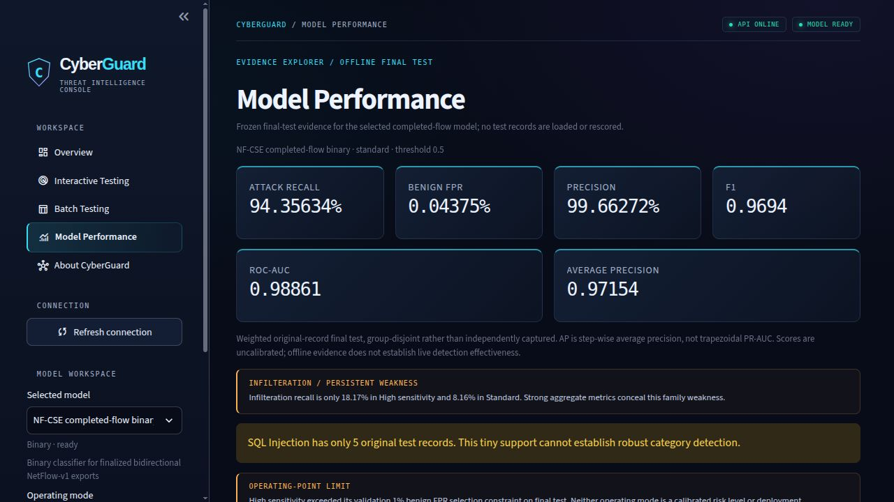
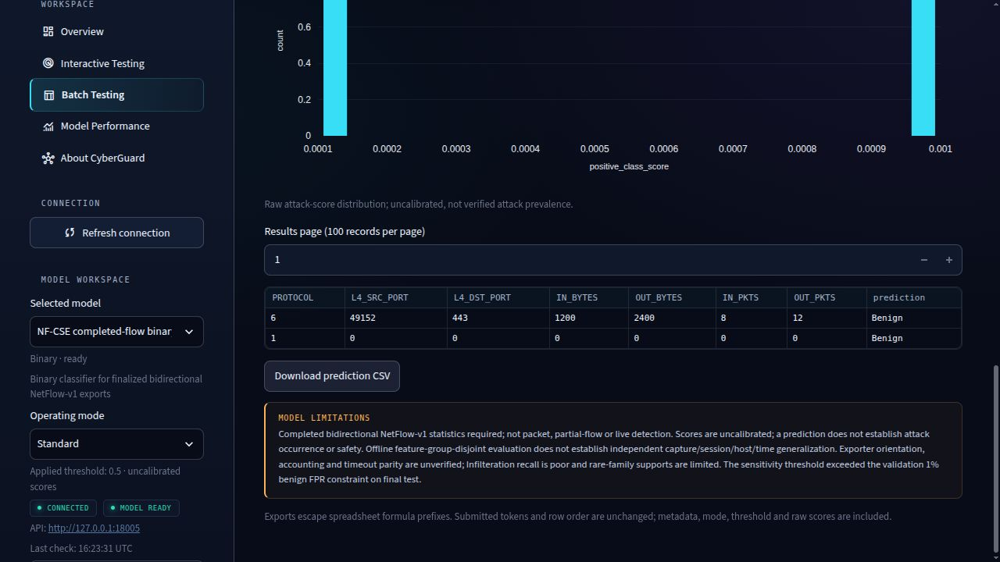
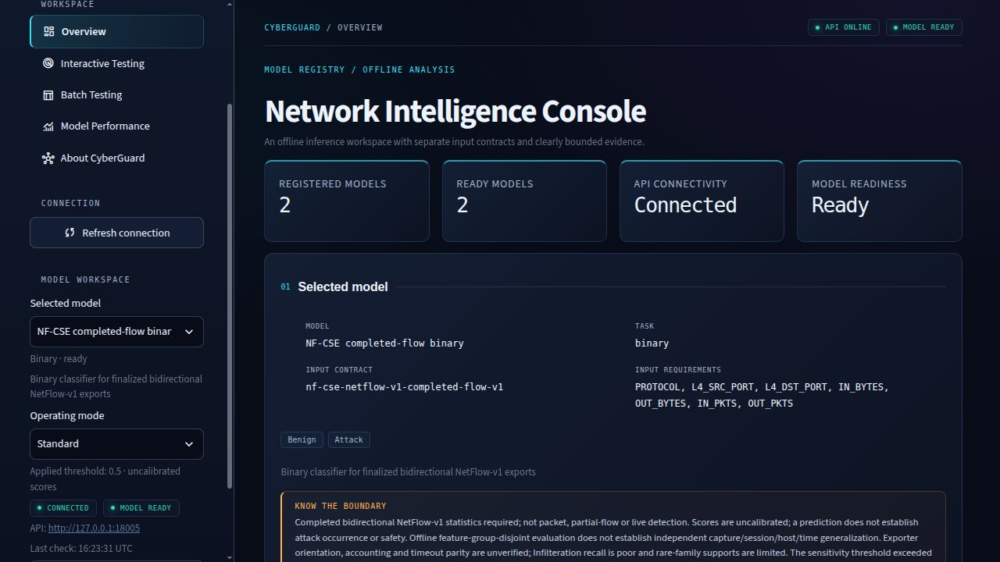
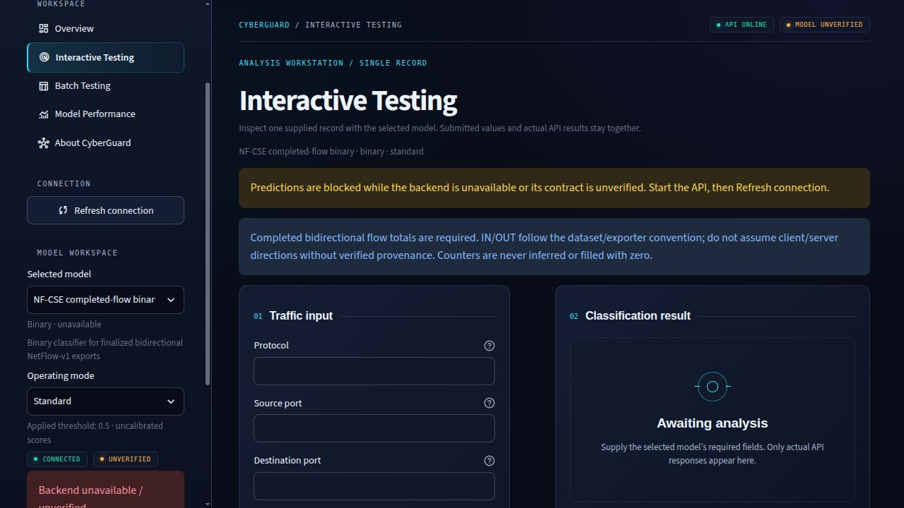
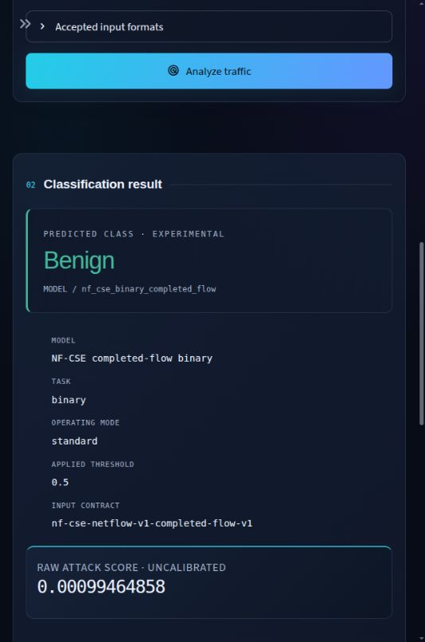

# Phase 5F: multi-model Streamlit integration

The cyberpunk dashboard now supports API-discovered BoT-IoT multiclass and NF-CSE binary completed-flow inference. Backend contracts, model artifacts, preprocessing implementations, thresholds, partitions and frozen evaluation outputs were preserved. No fitting, calibration, reserved-data reevaluation or live monitoring was implemented.

## Implementation and UI

The sidebar model selector uses the backend registry's order, names, tasks, descriptions, classes, features, schemas, readiness and modes. Models are not hardcoded into a frontend list. `GET /api/v1/models`, model details and per-model readiness replace the legacy single-model connection assumption. The original legacy client methods remain available for compatibility/software regression tests; the actual dashboard uses the additive model-specific endpoints.

`dashboard/contracts.py` defines public metadata/prediction contracts and local scalar validation; `model_ui.py` owns registry-aware forms, batch workflows and session transitions. The existing API client retains its shared HTTP request logic, 10-second timeout, bounded response reads, sanitized errors and no automatic retries. Metadata is fetched initially, on explicit refresh and when activating another model, with no per-widget metadata polling. Responses must match model ID, artifact-hash version, task, vocabulary/class-score order, input contract, mode and applied threshold before display. The frontend does not threshold scores or reinterpret the backend's class decision.

Inputs derive their exact names/order and scalar types from public metadata. The NF JSON schema omits some integer-string/sentinel rules, so a narrowly scoped adapter for `nf-cse-netflow-v1-completed-flow-v1` validates its protocol aliases, port/sentinel syntax and packet/byte ranges using metadata. It returns original tokens and does not implement normalization. Numeric text has a local bound of 128 ASCII characters. Unsupported schemas need a reviewed adapter rather than guessed field types. BoT's common/custom protocol, null controls, port token semantics, labels and score colors are preserved.

NF presents seven required controls with readable labels and exact-name help. Counters start blank, never implicitly zero. The form explains completed bidirectional observations and unverified IN/OUT-to-client/server orientation. Results include class, model/task, mode, applied threshold, raw positive-class score, class scores, input contract, submitted record and limitations. Benign uses restrained green; Attack uses amber. Scores remain explicitly uncalibrated.

Mode names, defaults and thresholds come from API metadata. Standard is the NF default; High Sensitivity is optional. Only mode identifiers are submitted. The saved artifact and its thresholds are never altered. Single-mode models hide the selector. Per-model mode preferences and form values persist across navigation and switching. Model/mode changes clear predictions; model changes also increment the uploader key and clear incompatible upload/validation state. Refresh clears results/uploads without silently changing the selected ID. If a selected model disappears or its metadata becomes unverifiable, another model's evidence is not substituted.

Batch workflows preserve the 5 MiB / 20,000-record limits, UTF-8/token handling, unique headers, row order, local extra columns, formula-safe CSV export and complete-result-only behavior. All selected-contract records validate before the first HTTP call. Requests use the smaller of the advertised OpenAPI limit and 250 records. A failed chunk discards the attempted complete result. Templates contain required headers only, with no fabricated traffic/labels; the previously documented four-row synthetic BoT demonstration remains available. NF shows Benign/Attack counts and percentages, selected mode and an uncalibrated attack-score histogram. Downloads include original columns plus model/version, mode, threshold, contract, timestamp and scores. Counts describe the uploaded sample and are not verified network attack prevalence.

Overview retains the existing visual vocabulary while showing registered/ready model counts, connectivity, selected task/contract/readiness and separate model cards. The BoT historical validation snapshot and per-class supports remain available for matching artifacts. About now explains the two-model request path and why the inputs/evidence differ. Local CSS, dark navy glass cards, cyan/violet accents, monospace details, existing BoT colors and reduced-motion handling are preserved; desktop columns stack on narrow screens.

## Performance evidence

BoT retains its stored historical validation summaries, per-class precision/recall/F1, logarithmic supports and exact/normalized confusion matrix. Matched selected artifact versions prevent attribution to a different model.

NF reads only an explicit allowlist of published final-evaluation files: manifest, test metrics, attack-family recall CSV and existing ROC/PR/family SVGs. Content hashes and selected artifact association are checked; no model/dataset is opened and no metric is regenerated. Standard shows recall 94.3563%, benign FPR 0.043752%, precision 99.6627%, F1 0.969370; sensitivity shows 94.9925%, 1.24108%, 91.2947%, 0.931069. ROC-AUC 0.988610 and step-wise AP 0.971543 are threshold independent. These values come from actual stored artifacts, not frontend constants.

Infilteration's 18.17% sensitivity / 8.16% standard recall, SQL Injection's five test records, the sensitivity FPR constraint failure, uncalibrated scores and group-disjoint rather than independent-capture evidence are prominent. Missing/inconsistent local artifacts show a warning with a labeled verified API summary fallback where available. Different datasets/tasks/evaluation conditions prohibit direct BoT-vs-NF ranking.

## Verification

Complete suite: `UV_CACHE_DIR=/tmp/cyberguard-uv-cache uv run --frozen --offline pytest -q` — **344 passed in 11.76 seconds**. The new multi-model dashboard module contributes **35 tests**. Focused tests use mocked HTTP, synthetic records, temporary hashed reports and Streamlit AppTest. They cover discovery/order/details/readiness, dynamic fields, local validation, operating modes, metadata-response agreement, preservation of backend decisions, whole-upload validation, batch ordering/chunk failure, header-only templates, CSV export, model switching/stale-state clearing, persistent preferences, failed refresh isolation, unavailable/empty registries, report hashes and metric rendering. Existing BoT HTTP/CSV/UI/design regressions remain in the suite. Dashboard import tests prohibit model-loading, preprocessing and training imports.

Manual browser checks used the actual frozen artifacts with explicitly synthetic software inputs, not reserved dataset records:

1. Launched the backend using `bash scripts/start_api.sh` with a temporary port 18005. The dashboard launcher was exercised; port 8501 was occupied by an existing service, which was left untouched. The documented direct Streamlit command ran an isolated instance on 8502 with `CYBERGUARD_API_URL=http://127.0.0.1:18005`.
2. Both registered models appeared in API order. NF selection and operating mode persisted across Interactive Testing, Model Performance, Batch Testing and Overview.
3. BoT interactive tcp/49152/80 returned DDoS. The existing synthetic batch demonstration returned DDoS, Normal, Reconnaissance, Normal in order. The prediction CSV downloaded successfully and its four rows and metadata columns were inspected.
4. NF's synthetic finalized-flow record (protocol 6, ports 49152/443, bytes 1200/2400, packets 8/12) returned Benign with raw attack score 0.0009946485796402205. Standard and High Sensitivity mode submission worked; changing mode cleared the old result. No frontend decision was calculated.
5. NF rejected a BoT-shaped CSV with the exact missing-column message before inference. Two explicitly synthetic completed-flow records then returned Benign, Benign in order. Counts, percentages, score histogram and prediction download worked. The downloaded CSV contained two ordered records plus mode, threshold, contract/version and score columns.
6. Standard and High Sensitivity performance pages displayed the stored metrics, correct confusion counts, family warnings and existing ROC/PR/family figures. About displayed the multi-model architecture and evidence boundaries.
7. The temporary API was restarted with an intentionally missing NF artifact path (no file changed). Refresh kept NF selected, showed one ready model, and disabled its prediction button without falling back to BoT. Restoring the normal verification configuration and refreshing recovered NF readiness/inference.
8. Inspected desktop (1280-pixel) and narrow (534-pixel) layouts. Forms/cards stack on narrow screens; the sidebar can collapse. Screenshots below show actual rendered output. Temporary verification servers were stopped afterward; the user's existing port-8501 service was not disturbed.

The first non-interactive verification sessions ended during browser checks; fresh live-terminal instances resumed the workflow. Streamlit showed a reconnect/deep-link notice after restart; navigation through the sidebar recovered normally. These were local verification-session interruptions, not failed inference results. The successful upload/download workflows were subsequently completed and the saved CSVs inspected.

Ruff, formatting and whitespace checks passed. Both model SHA-256 hashes remain unchanged: BoT `93b744ada3af044e2d0e7d4dd6d5fa70870536e7a972443c806a232ce9052c6f`; NF `598129ae5580ad386937f78f4a9d7f8a668557e63cd15db20fcbde9696665e7a`. The frozen NF normalizer and every hashed final-test output also still match their manifest. No partition files were needed for these checks.

## Screenshots

Desktop frozen evidence, including exact metrics and prominent limitations:

Model-specific batch output and download:

Registry-aware overview:

Unavailable model remains selected and blocked:

Narrow-layout prediction card and raw score:

## Remaining limitations

- Cold offline sessions cannot discover the API registry; restore connectivity to choose/verify models. Cached metadata/readiness are snapshots, not monitoring. Refresh may clear an upload, and results are intentionally session-local.
- Public metadata supports the current scalar contracts; new complex schemas/semantic validators need a reviewed adapter. The API remains the authoritative validator and inference owner. Very long NF numeric tokens are rejected locally even if some backend padded-integer forms would parse.
- Required field presence cannot authenticate completed-flow provenance or exporter parity. The caller must supply correct finalized observations.
- The application remains a local unauthenticated research workspace. Scores are uncalibrated; classes/counts do not prove attacks, safety, real-world prevalence, live detection or independent-session generalization.
- NF family weaknesses and tiny supports remain; frontend integration changes none of the frozen performance findings. DNS, packet capture and live monitoring remain unimplemented. Backend contracts and legacy clients are unchanged.

The root README documents current model/mode selection, forms, CSV requirements/templates/downloads, report sources, launch commands, tests and troubleshooting. The permanent README maintenance instruction remains in AGENTS.md. Scope stops at frontend integration.
