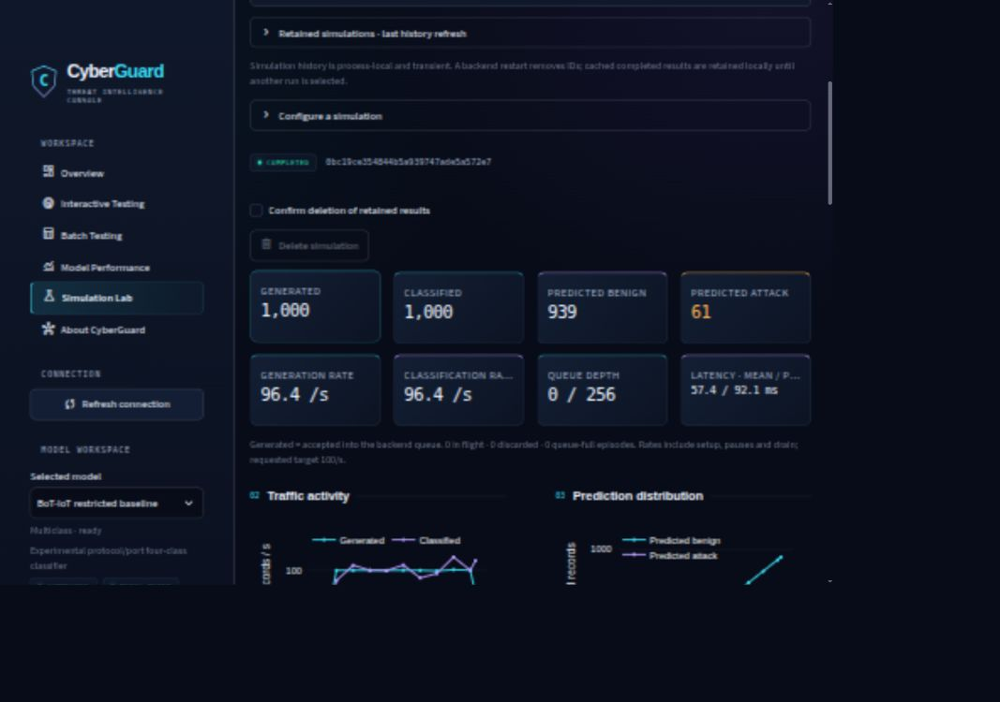

# Phase 6C — Streamlit Simulation Lab

Implemented and verified on 2026-11-15–16, Python 3.13, CPU only. The existing dashboard now controls the Phase 6B simulation service over HTTP. No classifier, threshold, partition, generator profile or engine implementation was changed for Phase 6C. No validation or reserved test records were accessed. Existing uncommitted Phase 6A/6B work was preserved.

## Implementation and UI architecture

Simulation Lab joins the existing navigation alongside Overview, Interactive Testing, Batch Testing, Model Performance and About. Existing theme/components supply the navy glass cards, cyan/violet accents, emerald status and amber prediction emphasis. Simulation styling is scoped to this page's status and metric containers. Desktop (1280×900) and narrow (534×806) layouts were inspected through the browser; the narrow layout stacks cards and keeps the sidebar collapsible. Tables support horizontal scrolling.

| Module | Responsibility |
| --- | --- |
| `src/cyberguard/dashboard/pages/simulation_lab.py` | Configuration, history, lifecycle, fragment monitoring, event inspector, summaries and downloads |
| `src/cyberguard/dashboard/api_client.py` | Existing timeout/configuration reused for all simulation HTTP calls; centralized sanitized errors |
| `src/cyberguard/dashboard/simulation_contracts.py` | Frontend public-response DTOs, count/sequence/ID checks, discovered configuration-bound validation |
| `src/cyberguard/dashboard/simulation_ui.py` | Bounded session state, cursors, lifecycle guards, chart data and export preparation |
| `src/cyberguard/dashboard/simulation_charts.py` | Existing Plotly/theme-based figures; no new dependencies |
| `tests/unit/test_simulation_dashboard.py` | Mock HTTP, pure-state and Streamlit AppTest regression coverage |

Streamlit imports no generator, inference worker or artifact loader. NF-CSE is the sole simulation target, independently of the sidebar model selection. Model readiness, human-readable name, operating-mode identifiers and thresholds come from model metadata/readiness endpoints. Limits come from the existing `/openapi.json` creation schema and model batch limit. No second engine, inference service, local threshold decision or packet generation was introduced.

## Configuration and lifecycle

The form supports empirical replay or bounded synthetic generation, complementary benign/attack profile percentages, accepted 10/50/100/250/500 rate presets, whole-second duration, maximum records and optional seed. Advanced settings expose batch size, queue capacity and backend event retention. Blank seed omits the field so the advertised backend default applies. The UI currently offers 1–3600 whole seconds; the backend accepts durations >0 through 3600 seconds. The submitted form validates finite scalar values, API bounds, ratios, readiness, operating mode and batch limits before POST.

Creation is explicit and separate from Start. The frontend locks Create after submission; Prepare new simulation explicitly arms another request. An uncertain creation outcome requires history refresh and is never retried automatically. Actions depend on the last authoritative snapshot and backend transition checks. Start disappears after state changes; pause/resume and stop follow backend semantics. Stop preserves results and drains accepted work. Only finished runs expose Delete, with an explicit retained-results confirmation checkbox. Terminal runs never restart automatically.

History is a bounded backend snapshot, clearly marked as last refreshed. Selecting another run clears that run's frontend cursors/events/charts/inspector while keeping unrelated dashboard state. Configuration remains inspectable for selected runs through the summary/configuration export. Backend history and running workers remain process-local and transient.

## HTTP integration and polling

The client implements list/create/get/start/pause/resume/stop/delete, metrics and exclusive-cursor events using the actual existing endpoints. DTO checks reject mismatched IDs, malformed counters, nonfinite values, incompatible records, unordered/duplicate event pages and invalid cursors. Responses remain subject to the existing 4 MiB client response bound. HTTP 404/409/422/429/503, timeouts and connection failures become readable API errors; raw response bodies/tracebacks are not rendered.

The supported `st.fragment(run_every=...)` mechanism polls every 500/750/1000 ms (1000 default); auto-refresh can be disabled. Each tick reads state/metrics and at most two 500-event pages. There is no polling thread, blocking loop, unbounded catch-up loop or automatic mutation retry. At a terminal state the frontend drains available pages and performs one full rerun to remove the timer. Created runs do not continuously poll. Errors stop polling until explicit Refresh Lab.

Each session retains at most 1,000 events, 120 metric snapshots and the bounded server simulation list. The visible table shows the most recent 100 events; the inspector/CSV use up to 1,000. Events are sorted and deduplicated by sequence; exclusive cursors advance incrementally. Switching simulations resets run-specific buffers. A ring-buffer cursor gap is disclosed as missing history, distinct from pipeline discard. An inspector selection that was evicted safely resets to a retained event.

On disconnection or restart, the last verified snapshot/events remain available for inspection/export. Refreshed history identifies no-longer-retained IDs and blocks lifecycle operations. A malformed/stale selection is sanitized before HTTP and produces recovery guidance. Manual hot-reload/restart testing exposed an uncaught invalid-selection path; it was fixed and six additional regression cases now cover it. The precise cause of that stale value during development was not established; the final API client rejects it without a raw traceback.

## Charts, metrics and interpretation

- KPIs show generated/classified counts, model-predicted benign/attack, actual rates, queue depth, mean and recent p95 latency.
- Traffic activity uses adjacent observed backend cumulative counters divided by their actual elapsed interval. There are no invented interpolated history points.
- Prediction counts, queue depth, lifetime classification rate and latency use bounded snapshots observed by this session. Queue depth and throughput have separate axes.
- Latency is admission to inference/score verification completion, excluding event aggregation/rendering. Mean is lifetime record-weighted; p95 covers up to the latest 2,000 backend latency samples. Displayed milliseconds are aggregate snapshots, not interval-specific latency measurements.
- **Prediction Agreement with Generator Profiles** shows backend lifetime agreement plus separate source/prediction marginal bars. The API exposes no full-run joint cross-counts, so no confusion matrix is inferred from retained events. Generated-profile and classified-prediction denominators can differ while draining.

Source profiles are training-derived labels, not independently verified attack traffic. Agreement is not independent test accuracy. Scores remain uncalibrated. This UI does not establish live packet-level detection or deployment effectiveness.

## Exports and resource bounds

Downloads provide actual retained-event CSV (sequence/time/profile, seven inputs, prediction, score, operating mode), configuration JSON and aggregate metrics JSON. The CSV uses the existing safe export helper. A full classified-event claim requires a finished run, no known cursor gap and every sequence from zero through classified−1 retained. All other event exports are labeled partial. Full-run metrics always come from the backend rather than a truncated frontend event sample. Exports cannot restore overwritten events; no storage was expanded to make them complete.

The backend alone owns workers, profiles and model reuse. Frontend state/DataFrames/figures are bounded; no repeated classifier loading or accumulated full-run DataFrames occur. Timing under CPU contention and with different batch settings varies. No new peak-RSS benchmark was performed for Phase 6C; the earlier Phase 6B measurement is not presented as a dashboard memory measurement.

## Automated verification

Commands run from the repository root with the locked environment:

```bash
UV_CACHE_DIR=/tmp/cyberguard-uv-cache uv run --frozen --offline pytest tests/unit/test_simulation_dashboard.py -q
UV_CACHE_DIR=/tmp/cyberguard-uv-cache uv run --frozen --offline pytest -q
```

**45 Simulation Lab tests passed in 2.77 seconds. The complete suite passed 489 tests in 28.90 seconds, with no warnings.** API integration tests were run with local sockets available. Ruff checks and formatting checks passed for all seven changed/new Python frontend/test files; `git diff --check` passed.

Coverage includes HTTP methods/paths/timeouts, response/schema/error validation, unavailable models/backends, invalid transitions, local configuration rejection, duplicate and uncertain creation guards, lifecycle controls/delete confirmation, session persistence, run switching, restart/missing ID recovery, cursor gaps/deduplication/order/bounds, evicted inspector selections, chart preparation/axes, metric formatting, downloads and preservation of existing page navigation. Fixtures are small synthetic software data and mocked HTTP responses. They do not access held-out records or establish classifier generalization.

## Manual verification

The API launcher and equivalent Streamlit command were run on temporary local ports to avoid existing services:

```bash
OMP_NUM_THREADS=2 OPENBLAS_NUM_THREADS=2 CYBERGUARD_API_PORT=18007 bash scripts/start_api.sh
CYBERGUARD_API_URL=http://127.0.0.1:18007 uv run --frozen --offline streamlit run src/cyberguard/dashboard/app.py --server.address 127.0.0.1 --server.port 8503
```

The default launchers remain documented in the root README. The temporary verification processes were stopped afterward. No real network attack traffic was sent; HTTP requests went to the local API.

### A — Natural completion

The final browser run `0bc19ce354844b5a939747ade5a572e7` used NF-CSE, synthetic mode, 100/s, 90/10 profiles, Standard mode, seed 42, 1,000 records, duration cap 60 seconds, batch 32, queue 256 and event retention 1,000. Metrics, charts and event cursors updated; terminal summary appeared and recurring polling stopped. The frontend retained sequences through cursor 999 and identified its export as complete for classified events.

| Observed value | Result |
| --- | ---: |
| Generated / classified / discarded | 1000 / 1000 / 0 |
| Generated benign / attack profiles | 900 / 100 |
| Model-predicted benign / attack | 939 / 61 |
| Source-profile agreement | 957 / 1000 (95.7%) |
| Actual generation and classification rate | 96.40/s |
| Mean / recent p95 end-to-end latency | 57.37 / 92.06 ms |
| Queue high-water / queue-full episodes | 4 / 0 |
| Completion | completed / max_records |

A separate earlier browser run `ac4f22f67981440dac149662dac0125f` used batch **1**, the same seed/composition/1,000-record ceiling and completed with the same 939/61 predictions and zero discards, but observed **67.91/s**, mean **1954.95 ms**, p95 **3815.88 ms**, queue high-water 256 and 103 queue-full episodes. Development/test/UI load overlapped that session. Batch settings and scheduling differed; these observations are not a controlled benchmark attributing the difference to one cause or a guarantee of sustained capacity.

### B/C — Pause, resume and stop

Longer browser run `da5c8746e49e4bea9bbb01fffce13c9b` used a 6,000-record ceiling, batch 1 and 60-second duration cap. Pause reached the backend `paused` state with 101 accepted / 78 classified and 23 queued records. Repeated backend history points remained at those counters while paused. Resume advanced processing/generation; the browser Stop control then ended generation and drained accepted work.

Final state: **stopped / user_stop**, **803 accepted = 803 classified**, zero queued/in-flight/discarded records. Source profiles were 720 benign / 83 attack; predictions 750 benign / 53 attack; source agreement 769/803 (95.77%). Lifetime rate was 12.61/s including the long pause/setup/drain, mean/p95 end-to-end latency 3986.70/4574.76 ms, queue high-water 256. The configured 6,000 records were not claimed as generated. Elapsed time (63.68 s) exceeded the generation cap while draining, consistent with the existing backend semantics.

### D — Error handling

- Stopped the temporary API, then refreshed Lab: a readable connection error appeared, live polling/actions stopped and cached completed metrics/events/exports remained visible.
- Restarted the API: prior IDs disappeared from server history, the UI identified the missing run and retained cached results. Repeated after the final selection-error fix.
- Launched a temporary backend with `CYBERGUARD_NF_CSE_MODEL_PATH` pointing to a nonexistent `/tmp` artifact; actual model files were untouched. Lab displayed NF-CSE unavailable and disabled creation, without offering another target. Restored the normal backend afterward.
- Entered `not-a-seed` and clicked Create in the browser: local validation displayed “Random seed must be an integer in the API range”; no create request was submitted. Corrected seed 42 and successfully created/ran the final 1,000-record simulation.
- Queried a valid-shaped unknown ID using the actual frontend API client: HTTP **404**, sanitized message “Simulation no longer exists. The backend may have restarted; refresh simulation history.” Malformed IDs are rejected locally before HTTP, covered by regression tests.
- Missing-profile worker failure, transition races and timeout mappings have automated coverage across existing backend/client tests; a missing-profile failure was not separately induced in the real browser session.

### E — Navigation and downloads

Navigated to Overview and back during the retained 803-record run. The selected ID and cached results persisted and server history still contained the same two runs; no duplicate creation occurred. Existing suite coverage for the other dashboard pages remained passing.

Downloaded the actual retained-event CSV through the browser. Reading the downloaded file verified **803 rows**, exact sequences **0–802**, and expected feature/prediction columns. JSON exports were checked through AppTest/download preparation tests. Terminal Delete was visibly disabled until confirmation and was exercised with Streamlit fixtures; retained real browser results were not manually deleted.

Raw observed snapshots/metrics are in [phase6c_manual.json](phase6c_manual.json). Its `metrics` entry for the longer run records the pause observation; `final_metrics` records its finished counters. This evidence is transient simulation output, not held-out data.

## Screenshots

Actual browser captures, with no fabricated values:

- [Configuration form](phase6c_screenshots/01_configuration.jpg)
- [Narrow completed metrics](phase6c_screenshots/02_completed_metrics.jpg)
- [Desktop monitoring](phase6c_screenshots/03_desktop_monitoring.jpg)
- [Stopped summary: 803 accepted and classified](phase6c_screenshots/05_stopped_summary.jpg)
- [Event explorer and profile/prediction marginals](phase6c_screenshots/06_event_explorer.jpg)
- [Unavailable model / restart recovery](phase6c_screenshots/07_restart_recovery.jpg)
- [Final completed 1,000-record metrics](phase6c_screenshots/08_completed_metrics.jpg)
- [Cached metrics and safe restart guidance](phase6c_screenshots/09_cached_restart_metrics.jpg)



## Remaining limitations and scope

Backend history disappears at restart; frontend cache disappears with its Streamlit session and is replaced when another run is selected. History state is explicitly last refreshed. Poll snapshots do not recover historical predictions/latency from times when the page was closed. The two-page/tick bound can lag high event rates and retention can create visible gaps. HTTP calls retain the existing timeout and can delay an individual refresh; no automatic POST retry is attempted. Source/prediction joint counts are unavailable, so only honest full-run marginals/agreement are shown.

The sidebar model-workspace connection status is separately refreshed and may be older than the Simulation Lab status/errors; the page explicitly identifies its independent NF-CSE target. Backend request/schema/readiness checks remain authoritative. Authentication, durable storage, distributed workers, live capture and network attack execution remain unimplemented. This phase does not extend scenarios or retrain/evaluate classifiers.

Both saved classifier SHA-256 values remained unchanged:

- BoT-IoT: `93b744ada3af044e2d0e7d4dd6d5fa70870536e7a972443c806a232ce9052c6f`
- NF-CSE: `598129ae5580ad386937f78f4a9d7f8a668557e63cd15db20fcbde9696665e7a`

The root README documents current startup/configuration/lifecycle/monitoring/export/recovery behavior and links this report. `AGENTS.md` retains the permanent documentation maintenance rule. Phase 6C stops at the Simulation Lab UI.
